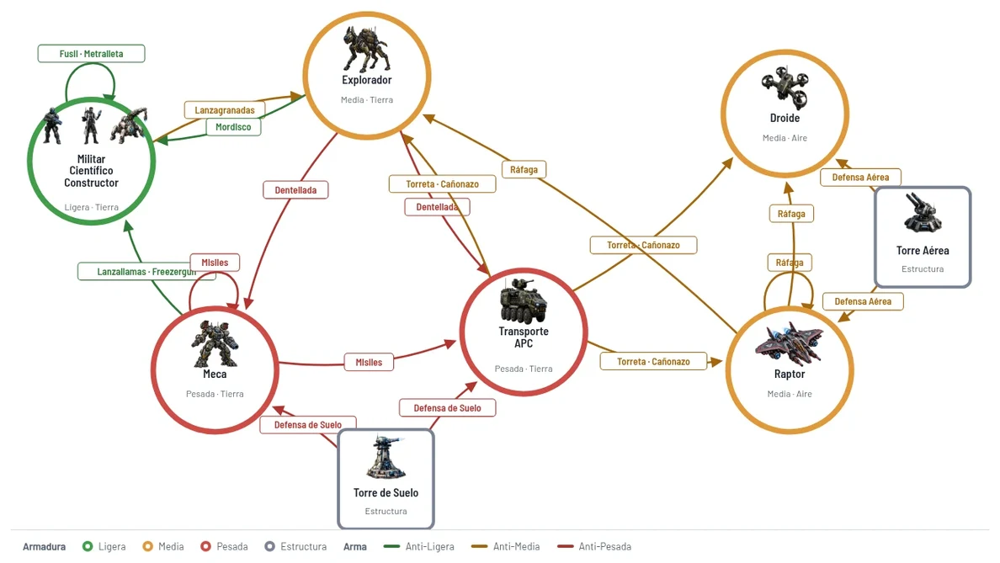

<p align="center">
  
</p>

<p align="center"><a href="README.md">English</a> · <b>Español</b></p>

<p align="center">
  <b>Estrategia por rondas simultáneas de ciencia ficción.</b><br>
  Todos ordenan a la vez; nadie espera su turno.
</p>

<p align="center">
  <a href="https://cesar-rgon.github.io/axiom-wars/">Web</a> ·
  <a href="https://discord.gg/3rsTp3DdGh">Discord</a> ·
  <a href="https://github.com/cesar-rgon/axiom-wars/releases/latest">Descargar</a> ·
  <a href="docs/unidades/README.md">Unidades</a> ·
  <a href="#balance-de-daños">Balance de daños</a> ·
  <a href="#criaturas-de-mapa">Criaturas</a>
</p>

> [!NOTE]
> Axiom Wars está en desarrollo. Las partidas de prueba se organizan en el [Discord](https://discord.gg/3rsTp3DdGh).

## Qué es Axiom Wars

Construye tu base alrededor del Gobierno, mantén alimentada a tu gente y lanza tus tropas a través de la niebla de guerra. Cuando todos los jugadores confirman sus órdenes, el servidor resuelve la ronda a la vez y ves cómo chocan los planes de todos.

Hasta 8 jugadores, todos contra todos o por equipos (hasta 4 contra 4). Los huecos se rellenan con bots.

### Así es una ronda

| Fase | Qué haces |
|---|---|
| **1. Planificar** | Encolas órdenes con tus Puntos de Acción (PA): construir, mover tropas, contratar, comerciar en el Banco. Ves el coste de cada orden antes de darla. |
| **2. Confirmar** | Marcas la ronda como lista. Puedes reordenar, pausar o cancelar órdenes mientras los demás deciden. |
| **3. Resolver** | El servidor ejecuta las órdenes de todos a la vez y lo ves como una repetición: marchas, choques, edificios que se levantan y lo que la niebla deja ver. |

### Lo que hay en juego

- **Seis recursos:** Energía, Madera, Acero, Comida, Agua y Combustible. Bosques, pastos, lagunas, pozos de petróleo y minas se agotan, y cada extractor necesita trabajadores y cobertura de energía.
- **Gente que come y protesta:** cada individuo consume comida y agua. Si racionas, baja su satisfacción; si cae del todo, desertan.
- **Niebla de guerra:** sólo ves lo que alcanzan tus unidades y edificios. Puedes ordenar construir a ciegas en terreno sin explorar.
- **Gobierno en tres niveles:** subirlo da más PA y cupo de tropas y desbloquea fábricas, lanzaderas y defensas. Si cae, quedas eliminado.
- **Banco:** trueque de recursos y préstamos a devolver en unas semanas de juego.
- **Victoria:** destruye el Gobierno enemigo. Gana el último que queda en pie.

## Galería

Capturas de la versión actual. Pulsa en una para verla a tamaño completo.

<p align="center">
  <a href="assets/img/galeria-17.webp"></a>
  <br><sub>Ronda 48 bajo la lluvia: una base desarrollada, un grupo de Mecas en el frente y las rutas de las órdenes planificadas dibujadas por el mapa.</sub>
</p>

<table>
  <tr>
    <td width="50%"><a href="assets/img/galeria-16.webp"></a></td>
    <td width="50%"><a href="assets/img/galeria-15.webp"></a></td>
  </tr>
  <tr>
    <td><sub>Mesetas y rampas: las tropas se mueven en grupo y los ataques Auto siguen a su objetivo, con la línea de tiro comprobada contra las mesetas.</sub></td>
    <td><sub>Ronda 4 bajo la lluvia: la interfaz nueva enmarca el mapa entre la columna de órdenes y la columna del minimapa, el panel de construcción y el turno.</sub></td>
  </tr>
</table>

## Museo

Axiom Wars empezó como un cliente de terminal. Estas son las versiones por las que ha pasado, de la más antigua a la más reciente.

| Etapa | Captura | Qué cambió |
|---|---|---|
| **1** | <a href="assets/img/museo/01.webp"></a> | **Cliente de terminal.** El mapa en caracteres ASCII y las órdenes escritas a mano: `build`, `move`, `end`. |
| **2** | <a href="assets/img/museo/02.webp"></a> | **Primera ventana.** Casillas de colores planos, edificios representados por letras y botones para construir. |
| **3** | <a href="assets/img/museo/03.webp"></a> | **Primeras texturas.** Agua, bosque y tierra dibujados, minimapa y el primer edificio ilustrado. |
| **4** | <a href="assets/img/museo/04.webp"></a> | **Edificios ilustrados.** Llegan el Gobierno, el Banco y el panel de construcción con iconos. |
| **5** | <a href="assets/img/museo/05.webp"></a> | **Trabajadores a la vista.** Cada extractor muestra bajo él cuántos de sus cuatro puestos están ocupados. |
| **6** | <a href="assets/img/museo/06.webp"></a> | **Terreno nuevo.** Hierba, lagos y bosques rediseñados, con los edificios marcados en el color del jugador. |
| **7** | <a href="assets/img/museo/07.webp"></a> | **Rondas simultáneas.** Cola de órdenes, panel lateral de construcción y el área de energía al colocar un edificio. |
| **8** | <a href="assets/img/museo/08.webp"></a> | **Planificación sobre el mapa.** El Constructor encadena órdenes de mover y construir, las flechas marcan su ruta y la cuadrícula muestra el área de energía del Gobierno. |
| **9** | <a href="assets/img/museo/09.webp"></a> | **Resolución simultánea.** Las lupas siguen las acciones que ocurren a la vez mientras se resuelve la ronda. |
| **10** | <a href="assets/img/museo/10.webp"></a> | **Órdenes numeradas.** Cola de órdenes numerada, áreas de efecto superpuestas y un Explorador camino de su destino. |
| **11** | <a href="assets/img/museo/11.webp"></a> | **Panel por unidad.** El panel lateral muestra las armas, habilidades y pasivas de cada unidad junto a la cola de órdenes pendientes. |
| **12** | <a href="assets/img/museo/12.webp"></a> | **Wikipedia.** Un archivo dentro del juego con los edificios, unidades y criaturas y todas sus cifras. |
| **13** | <a href="assets/img/museo/13.webp"></a> | **Tecnología.** Las armas, habilidades activas y pasivas de cada unidad por nivel de Gobierno, que se compran desde una ventana. |
| **14** | <a href="assets/img/museo/14.webp"></a> | **Interfaz flotante.** Menú, recursos, minimapa, un panel de construcción por nivel de Gobierno y un icono para cada tipo de orden. |

## Unidades de la Facción Terránea

Nueve unidades, de la mina al cielo. Cada ficha detalla producción, mantenimiento, defensa, movimiento y lo que desbloquea cada nivel de Gobierno.

| | Unidad | Clase | Vida | Escudo | Visión |
|---|---|---|---:|---:|---:|
|  | [Trabajador](docs/unidades/trabajador.md) | Civil, en su edificio | 50 | — | — |
|  | [Constructor](docs/unidades/constructor.md) | Ligera · civil | 50 | 50 | 4 |
|  | [Explorador](docs/unidades/explorador.md) | Ligera · cuerpo a cuerpo | 60 | 30 | 10 |
|  | [Militar](docs/unidades/militar.md) | Ligera · a distancia | 50 | 30 | 7 |
|  | [Científico](docs/unidades/cientifico.md) | Ligera · apoyo | 40 | 40 | 5 |
|  | [Transporte APC](docs/unidades/transporte_apc.md) | Media · transporte | 150 | 100 | 6 |
|  | [Meca](docs/unidades/meca.md) | Pesada · área | 250 | 150 | 6 |
|  | [Raptor](docs/unidades/raptor.md) | Media · aérea | 180 | 120 | 9 |
|  | [Droide](docs/unidades/droide.md) | Ligera · aérea | 60 | 120 | 8 |

Índice con el papel de cada unidad: [docs/unidades](docs/unidades/README.md) · Las nueve fichas para imprimir: [Fichas-Terranea.pdf](docs/unidades/Fichas-Terranea.pdf)

## Balance de daños

Cada arma hace todo su daño solo a la armadura para la que fue pensada, y cada tropa recibe daño máximo de exactamente tres atacantes (unidades y las dos torres), así que ninguna manda. Cada flecha sale del atacante y apunta a quien recibe el 100 % de daño de esa arma. El borde de cada nodo es su armadura.

<p align="center">
  <a href="https://cesar-rgon.github.io/axiom-wars/docs/balanceo/grafo-ataques.html"></a>
  <br><sub>Pulsa el grafo para abrir la <a href="https://cesar-rgon.github.io/axiom-wars/docs/balanceo/grafo-ataques.html">versión interactiva</a>: elige una unidad para resaltar a quién vence (o, con «Recibe daño máximo de», quién la vence) y oscurecer el resto. Elige un nivel de Gobierno (1, 2 o 3) para ver solo los ataques disponibles en él: el nivel 1 muestra los del Gobierno 1, el nivel 2 añade los del Gobierno 2 y el nivel 3 los muestra todos.</sub>
</p>

| Tipo de arma | Daño completo (100 %) a |
|---|---|
| Anti-Ligera | Armadura Ligera |
| Anti-Media | Armadura Media |
| Anti-Pesada | Armadura Pesada y Estructuras |

Solo la Defensa Aérea está limitada a unidades aéreas; los Misiles, la Torreta, el Cañonazo y la Ráfaga golpean tanto a tierra como a aire.

## Criaturas de mapa

Criaturas neutrales que no pertenecen a ningún jugador. Las dóciles deambulan por su hábitat y dan comida a quien las caza; las agresivas custodian los contenedores con premio: duermen enterradas hasta que una tropa junto al cofre elige luchar; entonces salen del suelo a su alrededor y luchan a muerte. Su nivel (1–5) fija el rango del que salen su vida, su escudo y su daño.

### Dóciles

| | Criatura | Hábitat | Vida | Comida |
|---|---|---|---:|---:|
|  | Bamber | Pradera | 30 | 30 |
|  | Tuki | Pradera | 60 | 60 |
|  | Sapino | Orillas de agua | 40 | 30 |
|  | Terima | Orillas de petróleo | 30 | 20 |
|  | Kronta | Llanura | 50 | 40 |

### Agresivas

| | Criatura | Nivel | Casillas | Ataque | |
|---|---|---:|:---:|---|---|
|  | Aquadeso | 1 | 1×1 | Cuerpo a cuerpo | Embosca con sus garras cerca del agua. |
|  | Obidicto | 1 | 1×1 | Láser (4) | Soldado alienígena que dispara pulsos láser a 4 casillas. |
|  | Arático | 2 | 1×1 | Telaraña (3) | Araña mecánica: su tela ralentiza a la presa 2 rondas. |
|  | Pescualido | 2 | 1×1 | Bola de ácido (4) | Escupe ácido: la mitad del daño atraviesa el escudo. |
|  | Serpenta | 2 | 1×1 | Cuerpo a cuerpo | Serpiente veloz de mordisco feroz. |
|  | Maricobra | 3 | 1×1 | Área venenosa (4) | Sus alas esparcen una nube venenosa sobre un área de 3×3. |
|  | Zarpatauro | 3 | 1×1 | Cuerpo a cuerpo | Bruto con garras hechas para romper blindaje pesado. |
|  | Aracnoso | 4 | 2×1 | Golpe aturdidor | Su golpe aturde al objetivo una ronda entera. |
|  | Cocodáctilo | 4 | 2×1 | Área de llamas (3) | Escupe fuego sobre un área de 3×3 que sigue quemando. |
|  | Devastador | 4 | 1×2 | Rayo perseguidor (6) | Su rayo salta en arco por hasta 3 objetivos cercanos, más débil en cada salto. |
|  | Rinotortuga | 5 | 2×1 | Cornada + misiles (5) | Mecánica. Su cuerno empuja a las tropas y sus baterías lanzan ráfagas de misiles sobre un área de 3×3. |
|  | Último Aliento | 5 | 2×2 | Zarpazo en área + llama azul (4) | El gran depredador: zarpazo en área que ralentiza y una llama azul que rompe todos los escudos que toca. |

## Descargar y jugar

| Sistema | Descarga |
|---|---|
| Windows 64 bits | [AxiomWars-Windows-x64.zip](https://github.com/cesar-rgon/axiom-wars/releases/latest/download/AxiomWars-Windows-x64.zip) |
| Linux x86-64 | [AxiomWars-Linux-x64.zip](https://github.com/cesar-rgon/axiom-wars/releases/latest/download/AxiomWars-Linux-x64.zip) |

1. Descomprime el zip y abre **AxiomWars.exe** (Windows) o **AxiomWars** (Linux) dentro de la carpeta `AxiomWars`. Deja la carpeta `assets` a su lado.
2. Abre el juego: la dirección del servidor ya viene rellena. Escribe tu nombre y crea una sala o únete a una.

## Histórico de cambios

La última versión es **v2026.10.21 alpha**.

<details>
<summary>Ver todas las versiones</summary>

### v2026.10.21 alpha

- Repeticiones de partida: el servidor graba cada turno y se ven desde el menú, con la vista de un jugador o sin niebla; «Repetir última resolución» con panel de reproducción
- Guardar partida manual y «Salir al menú»; la lista de guardadas indica el turno y si es manual o autoguardado
- Arreglo: el Constructor ya no se bloquea dentro de su huella al construir; la pantalla inicial deja de mostrar «Guardadas recientes»
- Tres idiomas nuevos: chino tradicional, coreano y polaco
- Pantalla inicial: el logo animado es el doble de grande y queda centrado sobre los paneles; la píldora del servidor se alinea con el panel izquierdo
- Cada jugador de la sala tiene su propio botón «Salir» (también los de tu PC): sale solo él, el PC se queda en la sala y, si era el anfitrión, el cargo pasa al jugador más antiguo de ese PC; solo el anfitrión conserva «Cerrar sala»

### v2026.10.20 alpha

- Pantalla inicial rediseñada: jugadores de este PC, lobbies y partidas guardadas en una sola vista, con la sala a la derecha
- Sala (lobby) a pantalla completa y «Cargar partida» con lista, miniaturas y detalle de tu base
- Seis idiomas nuevos: francés, italiano, alemán, ruso, chino y japonés
- Animaciones de reposo de las tropas terráneas y de las 17 criaturas
- Rebalanceo de daño y PA (matriz 100/70/40) y Gobierno con 14/20/26 PA y más vida
- El extractor de agua funciona también junto al mar
- Estadísticas de fin de partida, lupa y cámara en la caída del Gobierno, y mira de ataque
- La IA prioriza mejor a quién atacar; un grupo mandado a terreno inexplorado conserva su destino

### v2026.10.19 alpha

- Mapas v2: cuadrantes mayores, mar con ríos, bahías, lagos con isla y puentes
- Opciones de mapa en el lobby: continentes, penínsulas, lagos, ríos, mesetas, cofres, dóciles y nivel de recursos
- Guardianes de cofre enterrados que salen del suelo al luchar
- Grafo de ataques máximos y nuevos daños a escudos de edificio
- Las órdenes de cada unidad se ejecutan en el orden de la cola
- Se puede cancelar el fin de turno mientras las IAs planifican
- Ondas de agua y petróleo con interferencia; el petróleo y el mar bloquean el paso
- APC más rápido; un Explorador enterrado no puede moverse
- Servicio systemd del servidor

### v2026.10.18 alpha

- Rebalanceo de armas, armaduras y habilidades (metralleta, lanzagranadas, cañonazo, dentellada, Enterrar, Inmolar, Pisotón, Clonar, Aura PA)
- Un contraataque por tropa y ronda; defensas de suelo y aire según el nivel del Gobierno
- Transporte APC de armadura pesada; Cargar sin objetivo
- Rendimiento gráfico del cliente muy mejorado (formas con shader y frontera de niebla en imagen)
- Créditos con efectos de sonido, ChatGPT y Gemini

### v2026.10.17 alpha

- Catálogo de 58 efectos de sonido (los 58 en mp3)
- Aproximar y disparar son una sola orden
- Edificios sin energía inactivos: las defensas no disparan y los Bancos no operan
- Búsqueda de rutas y salida del Gobierno 15-20 veces más rápidas para la IA
- Botones de acción más grandes y 3 trabajadores por defecto

### v2026.10.16 alpha

- Unidades grandes con huella multicasilla: Meca y APC 2×2, Raptor 3×2
- Órdenes de grupo, colas civil y militar con pestañas, y mensajería con historial de avisos
- Sonidos sintetizados con volumen propio en Configuración
- Guardianes de cofre en tropas según el nivel del cofre; decoración de mapa que nunca desconecta el terreno
- Los muertos de la ronda ya no contraatacan; botón Salir en el menú principal

### v2026.10.14 alpha

- Texturas nuevas de contenedores, criaturas y terrenos

### v2026.10.12 alpha

- Explosión de edificios con escombros, caída del Gobierno en cadena y pools de recursos que se gastan a la vista
- Interfaz variante B (el mapa ya no queda tapado) y cursor de mano; el menú es un modal centrado
- IA: elige a quién disparar por valor, recuerda criaturas hostiles y genera energía de forma proactiva
- Línea de tiro con mesetas; habilidades de área que siguen a la tropa; llegada en grupo y formación por papeles
- Balanceo de recursos: más pasto y Energía que no castiga el ahorro
- Fichas de unidad e informe de balance en inglés y publicadas en la web

### v2026.10.11 alpha

- Doble bolsa de PA: PA común del campamento y PA propio de cada tropa
- Mesetas con estilo escarpado: rocas con estratos, grietas y rampas
- Tecnología, Wikipedia y órdenes con icono por tipo
- La IA respeta las mesetas al colocar edificios

### v2026.10.10 alpha

- Criaturas de mapa: 17 especies reales con texturas, animaciones de movimiento y de ataque
- Criaturas dóciles que viven en su lago; cofres con premio
- HUD flotante con fila de órdenes y paneles configurables; chat y movimiento con WSAD
- Sin turno 0; préstamo prioritario y tope de energía

### v2026.10.09 alpha

- Climatología: condiciones meteorológicas aleatorias por turno
- Criaturas neutrales y contenedores con premio
- Relevo entre jugadores locales, créditos y música de fin
- Animación de unidades al moverse y de edificios en obra

### v2026.10.08 alpha

- Asesora de campo con retrato real en el tutorial y el parte de ronda

### v2026.10.06 alpha

- Mesetas y rampas: un nivel de altura en el mapa, con acantilados
- Acercarse a distancia de tiro antes de atacar; clic derecho para atacar y arco de disparo
- Recursos explotables junto a cada Gobierno y más petróleo
- Tutorial con temario de avisos pendientes

### v2026.10.05 alpha

- Tutorial con la asesora holográfica y parte de ronda
- Laboratorio de efectos visuales: un efecto para cada arma, habilidad, pasiva y estado
- Panel derecho con rail por unidad, iconos de mejoras y escala de interfaz

### v2026.10.04 alpha

- Cansancio de las tropas, energía con techo y rutas por tramos (fresco, cansado, fuera de ronda)
- Construcción a ciegas en niebla sin explorar (sólo el Generador de Energía) y movimiento en grupo a la par
- Compra de pasivas, armas y habilidades; asalto de la IA
- Scripts de publicación de releases del cliente en GitHub y de la web

### v2026.10.03 alpha

- Balanceo Terráneo v8: clases, PA por individuo, combustible por casilla, escudo por individuo
- Armas por nivel con recargas, área y contraataque; habilidades, pasivas y estados
- Nuevas unidades y aviones en capa propia; transporte y minas
- Selector de arma y de habilidades en el cliente

### v2026.10.02 alpha

- Vista previa del mapa en el lobby con semilla fija, y mapa ampliado al pincharla
- Cancelar, pausar y reanudar cualquier orden de la cola con replanificación
- Panel de órdenes con fichas sobre riel numerado
- Fichas de unidad: Militar, Meca, APC, Raptor, Droide, Explorador y Científico

### v2026.10.01 alpha

- Lobby con combo de Equipo y botón Listo
- Lupa viajera y panel de órdenes con scroll; un Constructor por tropa
- Fichas de unidad Terráneas (PDF y Markdown)

### v2026.09.27 alpha

- Panel de avisos, lupas móviles y repetición simultánea
- Área de efecto «Campo de energía» con shader
- Movimiento fluido en la resolución y estela de ruta
- IA con Gobierno nivel 2, explorador dedicado y refuerzo de emergencia

### v2026.09.26 alpha

- Recalcular la ruta ante un obstáculo imprevisto
- Revelado de terreno al ordenar movimiento hacia la niebla negra
- Saetas eléctricas y previsualización del área al construir

### v2026.08.31 alpha

- Batch de 21 mejoras: dividir tropas, racionamiento real, lupas de resolución, punto de salida, victoria cooperativa
- Lupa automática al descubrir un enemigo o una base
- IA con especulación paralela y barra de progreso real

### v2026.08.30 alpha

- Cupo dividido en Civil (Vivienda) y Militar (Generador de Energía)
- Rebalanceo de extractores de agua y granjas
- La IA evita la espiral de deuda de Comida

### v2026.08.29 alpha

- Corrección de un cuelgue de la IA en la planificación paralela

### v2026.08.28 alpha

- La IA prioriza construcción, producción y mejoras según lo que puede pagar

### v2026.08.27 alpha

- La IA contrata todas las plazas libres, banca de forma proactiva y recuerda bases enemigas
- Balance de energía, acero y comida; el prado como recurso dominante
- Mira menos pixelada y fondo de la pantalla inicial a ancho completo

### v2026.08.25 alpha

- Hasta 8 jugadores locales y hasta 8 por lobby
- Cámara fija y mira de aumento durante la resolución, con pausa con Espacio
- 3 PA fijos por ataque y bloqueo de órdenes tras Listo
- Pegar en el campo Host; leyenda de atajos

### v2026.08.23 alpha

- Minas de hierro equidistantes entre jugadores
- Barra de progreso en vivo mientras resuelve la IA
- Finalizar lobby, y pantallas separadas para Buscar lobby y Cargar partida

### v2026.08.22 alpha

- Mapa de 8 jugadores con 49 cuadrantes
- La cámara enfoca los combates; Banco rediseñado
- El turno 0 se puede deshacer
- Wizard fusionado, idiomas con nombre completo y ráfagas con retroceso

### v2026.08.21 alpha

- La IA construye la economía en orden (madera, agua, granja, acero, energía) y contrata personal antes
- El Gobierno produce energía y suben los recursos iniciales
- Extractores construibles con una sola casilla adyacente

### v2026.08.20 alpha

- Nueva IA: RHEA (algoritmo evolutivo de horizonte rodante) sustituye a la IA por reglas
- Las construcciones en cola se ven también para enemigos con visión
- Recursos del Gobierno con separación mínima entre ellos

### v2026.08.19 alpha

- Orden estable de lobbies y producción por lotes no atómica

### v2026.08.18 alpha

- Logo animado en el wizard y en los cambios de turno
- Pantallas iniciales en formato 16:9; fecha en el listado de lobbies

### v2026.08.17 alpha

- Generación de mapa simétrica entre los cuadrantes
- PA fraccionados entre rondas para cualquier orden; costes de energía por nivel de Gobierno
- Turno 0 con confirmación o reubicación del Gobierno

### v2026.08.10 alpha

- Lobbies persistentes que se pueden reanudar; marchas largas que continúan solas
- Pathfinding completo sobre terreno real, oculto bajo la niebla
- Pausar, reanudar y reordenar órdenes; reserva de recursos en órdenes en cola
- Cola de órdenes de aliados; préstamos y Banco mejorados

### v2026.08.09 alpha

- Rondas simultáneas: todos los jugadores encolan órdenes y la ronda se resuelve a la vez
- Previsualización de rutas y costes de las órdenes en cola
- Sala de espera y repetición saltable

### v2026.08.08 alpha

- Sistema de satisfacción y racionamiento por individuo, en lugar de inanición
- Efectos ambientales de producción y ondas en agua y petróleo
- Minimapa que se coloca según el lado del mapa donde está el Gobierno

### v2026.08.06 alpha

- Bordes de terreno fundidos con el vecino y esquinas redondeadas
- El Constructor atraviesa criaturas neutrales de pasto
- Ayuda con barras de desplazamiento y estadísticas más ricas

### v2026.08.05 alpha

- Previsión de recursos con trabajos que terminan en la misma ronda
- Cobertura de energía en círculo real desde el centro del edificio

### v2026.08.04 alpha

- Guardados con nombre (checkpoints) y panel de ayuda
- Minimapa flotante y registro de chat en la parte inferior
- Historial del Banco y bloqueo de préstamos negativos
- Tooltips de recursos con desglose de PA y Cupo

### v2026.08.03 alpha

- Criaturas neutrales de pasto (vaca y caballo)
- Constructor limitado a una orden de construcción y exploración dual de la IA
- Rediseño de tooltips y bordes de terreno

### v2026.08.02 alpha

- Turno 0 obligatorio para colocar los edificios iniciales
- Área de energía del Gobierno; lagos centrales en la generación de mapas
- Panel rediseñado con tarjeta de información, botones con icono y cursores propios

### v2026.08.01 alpha

- Unidad Constructor y flujo de construcción
- Botón Listo en el lobby y cursor de texto editable
- Controles de ratón rediseñados y vista cooperativa en vivo
- Mapa justo entre jugadores y cobertura de energía

### v2026.07.31 alpha

- Dividir y fusionar tropas
- Iconos de hambre y sed; desplazamiento con teclado
- La cámara se recoloca al comienzo del turno; repetición del turno de la IA
- Mapas cuadrados y minas de acero 2×2

### v2026.07.30 alpha

- Las pantallas previas se fusionan en un único wizard
- Efectos de combate, pantalla de victoria y presupuesto de ataques por turno
- Validación de inicio del lobby PvP/Cooperativo

### v2026.07.29 alpha

- Multijugador local en el mismo PC (hotseat) con relevo entre jugadores
- Idiomas español e inglés, ventana de Configuración y volumen

### v2026.07.28 alpha

- Producción de unidades por lotes y transferencias de recursos entre aliados
- Pozos de petróleo como terreno nuevo con refinería adyacente
- Modal de cantidad de unidades y mejoras de interfaz

### v2026.07.27 alpha

- Multijugador con varios lobbies PvP/Cooperativos, guardado y carga de partidas
- Explorador de lobbies, pantalla de carga de partida y marca Axiom Wars

### v2026.07.26 alpha

- Movimiento por rutas de varios turnos con ruta punteada y tiempo estimado
- Venta de edificios, ataque a distancia y combate real
- Mapa más amplio y expansivo

### v2026.07.25 alpha

- Niebla de guerra, selección de color de facción y primera IA enemiga
- Combate cuerpo a cuerpo básico y Banco con préstamos
- Hambre y sed por individuo y previsión de recursos del siguiente turno
- HUD de partida rediseñado con barra superior de recursos y música

### v2026.07.24 alpha

- Comienzo del proyecto: servidor en Go y cliente gráfico con Ebiten
- Edificios de varias casillas, bosques como obstáculo y minimapa
- Vista previa roja/verde al construir y panel de construcción con pestañas por nivel
- Tema futurista cian sobre negro con la fuente Elianto

</details>

## Créditos

<table>
  <tr>
    <td align="center" width="17%" valign="top"><sub>Creador y analista</sub><br><br><b>RaseC</b></td>
    <td align="center" width="17%" valign="top"><sub>Programador</sub><br><br><b>Claude AI</b></td>
    <td align="center" width="32%" valign="top"><table>
      <tr><td align="center" colspan="2"><sub>Diseñadores</sub></td></tr>
      <tr><td align="center"></td><td align="center"></td></tr>
      <tr><td align="center"><b>ChatGPT AI</b></td><td align="center"><b>Gemini AI</b></td></tr>
    </table></td>
    <td align="center" width="17%" valign="top"><sub>Compositor</sub><br><picture><source media="(prefers-color-scheme: dark)" srcset="assets/img/credits/suno-pad.svg"></picture><br><b>Suno AI</b></td>
    <td align="center" width="17%" valign="top"><sub>Efectos de sonido</sub><br><picture><source media="(prefers-color-scheme: dark)" srcset="assets/img/credits/elevenlabs-pad.svg"></picture><br><b>ElevenLabs AI</b></td>
  </tr>
</table>

**Analistas colaboradores:** Gameover · Kattaros · Kiwi

**Testeadores:** Calheb · Chara · Fr4nk50 · Gameover · Kattaros · Kiwi · Miky · Navajita · Nightlane · RaseC

## Sobre este repositorio

Este repositorio aloja la web del juego (GitHub Pages) y las descargas del cliente (Releases). El código del juego se desarrolla aparte.

```
index.html          web publicada en https://cesar-rgon.github.io/axiom-wars/
assets/img/         logo, unidades, galería, museo y créditos
assets/js/i18n.js   selector de idioma de la web (por defecto, inglés)
assets/i18n/        un fichero por idioma: es, fr, it, de, ru, zh, zh-TW, ja, ko, pl, pt-BR, tr
docs/unidades/      fichas de las unidades Terráneas (Markdown y PDF)
docs/balanceo/      grafo interactivo de daños (español)
docs/units/         las mismas fichas en inglés
docs/balance/       el mismo grafo en inglés
tools/make_logo.py  recorta el logo original a PNG transparente
```

Cada release contiene sólo los binarios del cliente para Windows y Linux; el servidor no se distribuye.
