<p align="center">
  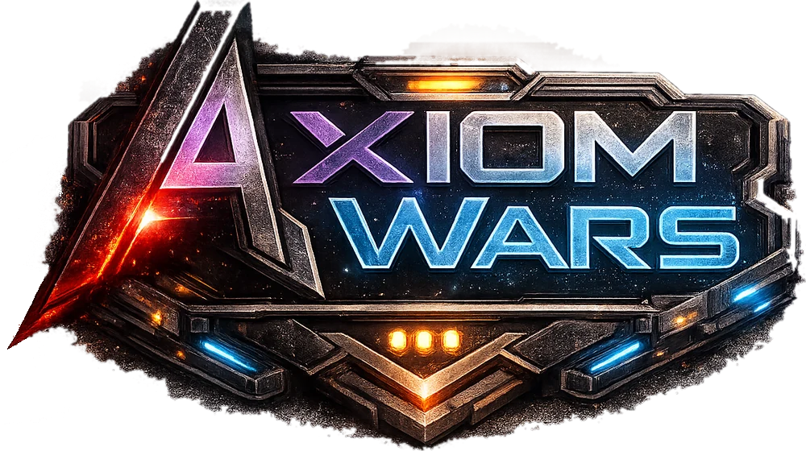
</p>

<p align="center"><b>English</b> · <a href="README.es.md">Español</a></p>

<p align="center">
  <b>Sci-fi strategy with simultaneous rounds.</b><br>
  Everyone gives orders at once; nobody waits for their turn.
</p>

<p align="center">
  <a href="https://cesar-rgon.github.io/axiom-wars/">Website</a> ·
  <a href="https://discord.gg/2EZAtyqtzW">Discord</a> ·
  <a href="https://github.com/cesar-rgon/axiom-wars/releases/latest">Download</a> ·
  <a href="#units-of-the-terran-faction">Units</a> ·
  <a href="#damage-balance">Damage balance</a> ·
  <a href="#map-creatures">Creatures</a>
</p>

> [!NOTE]
> Axiom Wars is in development. Test matches are organized on the [Discord](https://discord.gg/2EZAtyqtzW).

## What is Axiom Wars

Build your base around the Government, keep your people fed and send your troops through the fog of war. Once every player confirms their orders, the server resolves the round all at once and you watch everyone's plans collide.

Up to 8 players, free-for-all or in teams (up to 4 versus 4). Empty seats are filled by bots.

### How a round works

| Phase | What you do |
|---|---|
| **1. Plan** | Queue orders with your Action Points (AP): build, move troops, hire, trade at the Bank. You see what each order costs before you give it. |
| **2. Confirm** | Mark the round as ready. You can reorder, pause or cancel orders while the others decide. |
| **3. Resolve** | The server runs everyone's orders at once and you watch it as a replay: marches, clashes, buildings going up and whatever the fog lets you see. |

### What's at stake

- **Six resources:** Energy, Wood, Steel, Food, Water and Fuel. Forests, pastures, lagoons, oil wells and mines run dry, and every extractor needs workers and energy coverage.
- **People who eat and complain:** every individual consumes food and water. Ration them and their satisfaction drops; let it bottom out and they desert.
- **Fog of war:** you only see what your units and buildings can reach. You can order buildings blind on unexplored ground.
- **Three-level Government:** upgrading gives more AP and troop cap, and unlocks factories, launch pads and defenses. If it falls, you're out.
- **Bank:** resource bartering and loans paid back over a few in-game weeks.
- **Victory:** destroy the enemy Government. The last one standing wins.

## Gallery

Screenshots from the current build. Click one to see it full size.

<p align="center">
  <a href="assets/img/galeria-17.webp">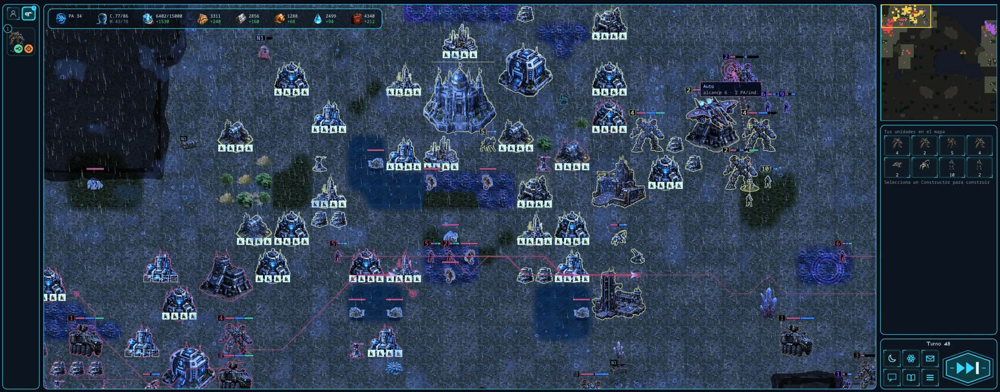</a>
  <br><sub>Round 48 in the rain: a developed base, a group of Mechs at the front and the routes of the planned orders drawn across the map.</sub>
</p>

<table>
  <tr>
    <td width="50%"><a href="assets/img/galeria-16.webp">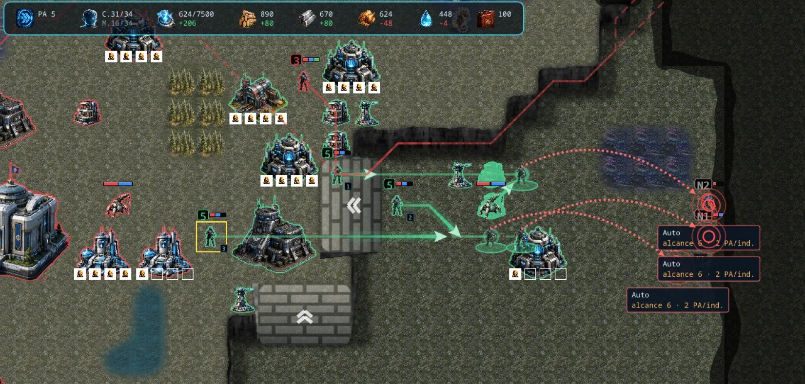</a></td>
    <td width="50%"><a href="assets/img/galeria-15.webp">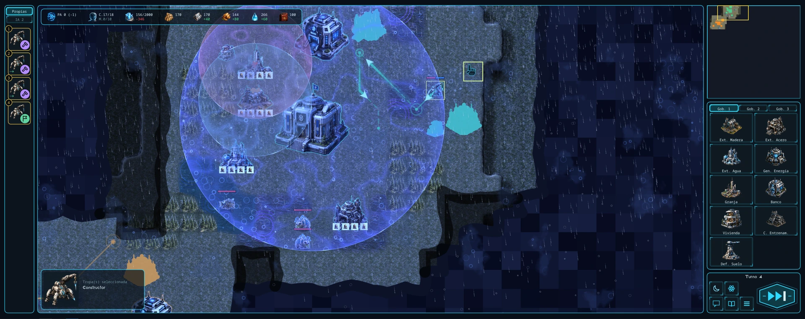</a></td>
  </tr>
  <tr>
    <td><sub>Plateaus and ramps: troops move as a group and Auto attacks follow their targets, with the line of fire checked against the plateaus.</sub></td>
    <td><sub>Round 4 in the rain: the new interface frames the map between the orders column and the column with the minimap, the build panel and the turn.</sub></td>
  </tr>
</table>

## Museum

Axiom Wars started out as a terminal client. These are the versions it has gone through, from oldest to newest.

| Stage | Screenshot | What changed |
|---|---|---|
| **1** | <a href="assets/img/museo/01.webp">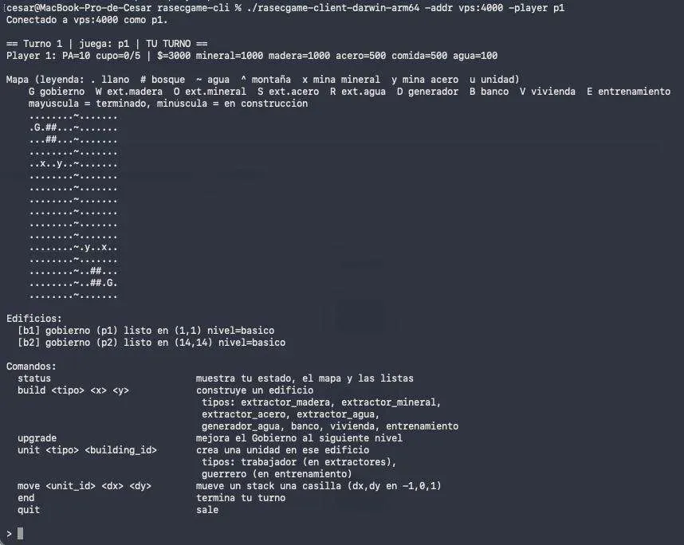</a> | **Terminal client.** The map in ASCII characters and orders typed by hand: `build`, `move`, `end`. |
| **2** | <a href="assets/img/museo/02.webp">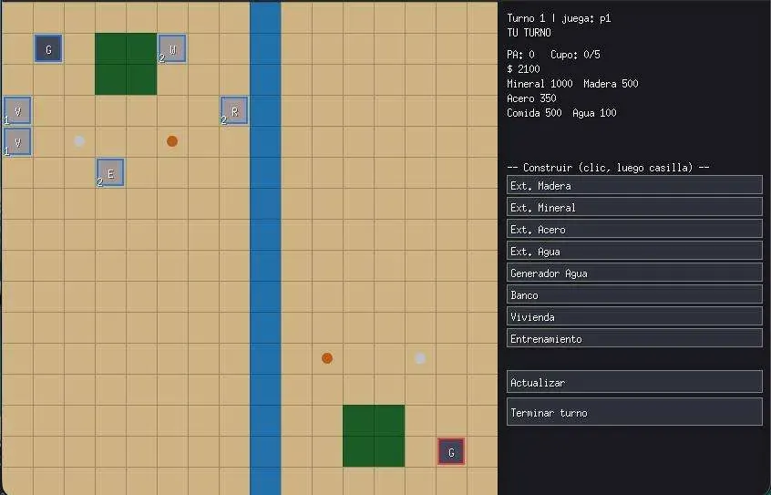</a> | **First window.** Flat-colored tiles, buildings shown as letters and buttons to build. |
| **3** | <a href="assets/img/museo/03.webp">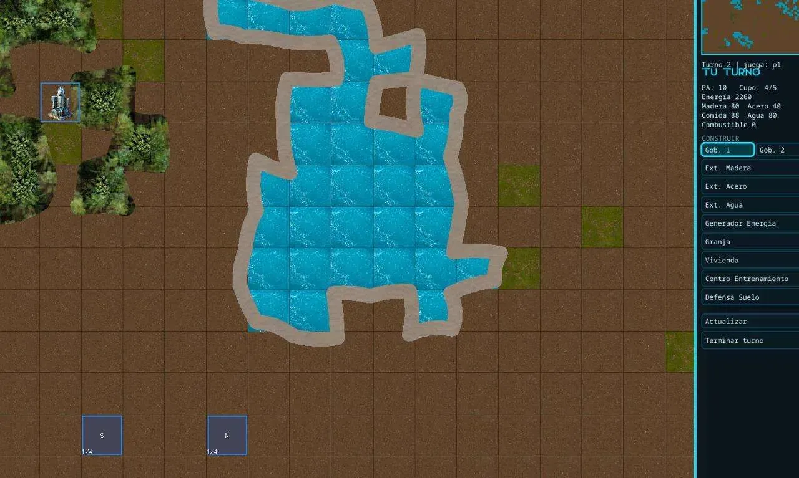</a> | **First textures.** Drawn water, forest and earth, a minimap and the first illustrated building. |
| **4** | <a href="assets/img/museo/04.webp">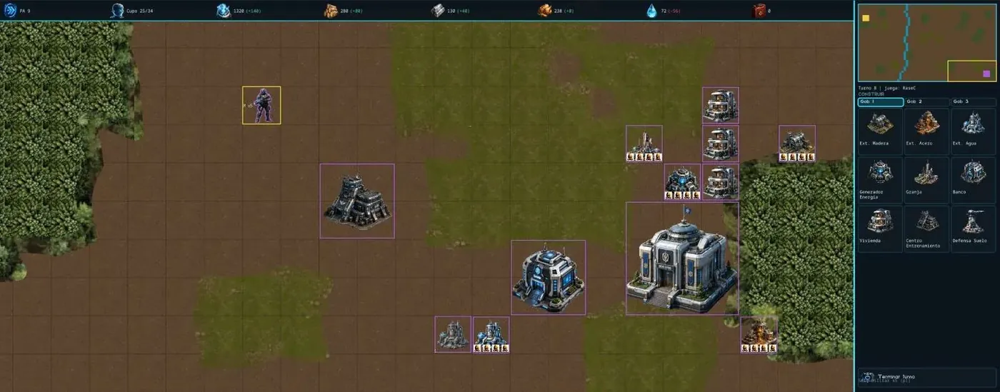</a> | **Illustrated buildings.** The Government, the Bank and the icon-based build panel arrive. |
| **5** | <a href="assets/img/museo/05.webp">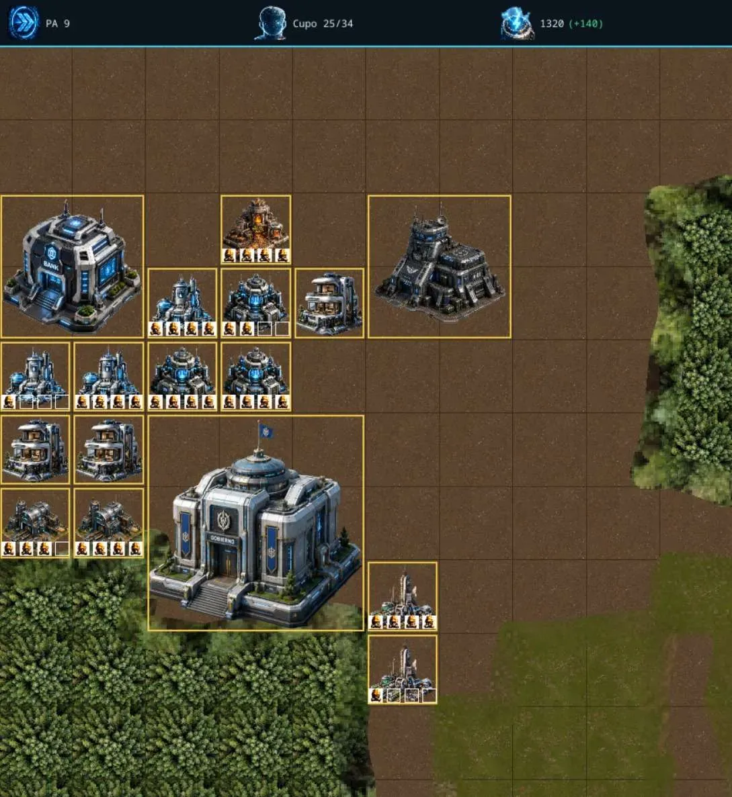</a> | **Workers on display.** Each extractor shows below it how many of its four slots are filled. |
| **6** | <a href="assets/img/museo/06.webp">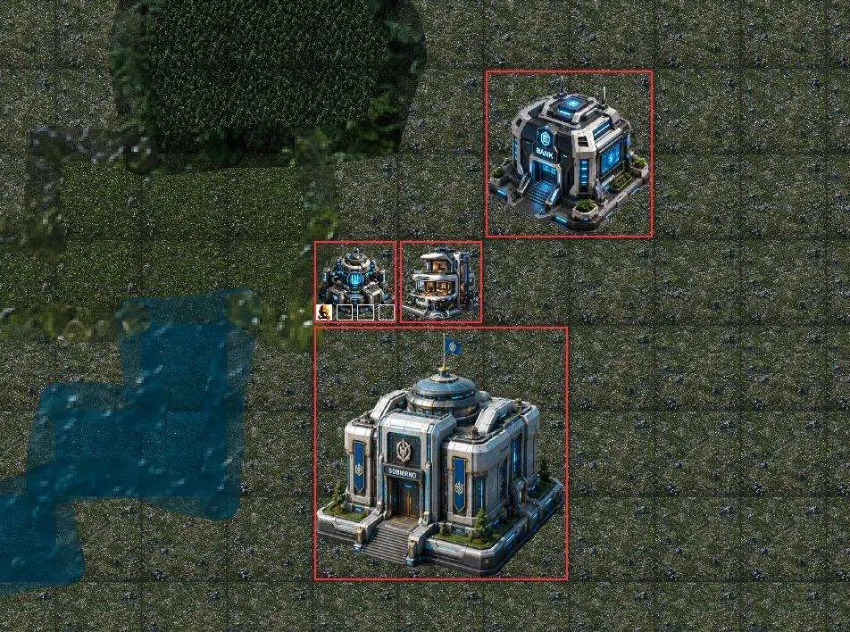</a> | **New terrain.** Redesigned grass, lakes and forests, with buildings outlined in the player's color. |
| **7** | <a href="assets/img/museo/07.webp">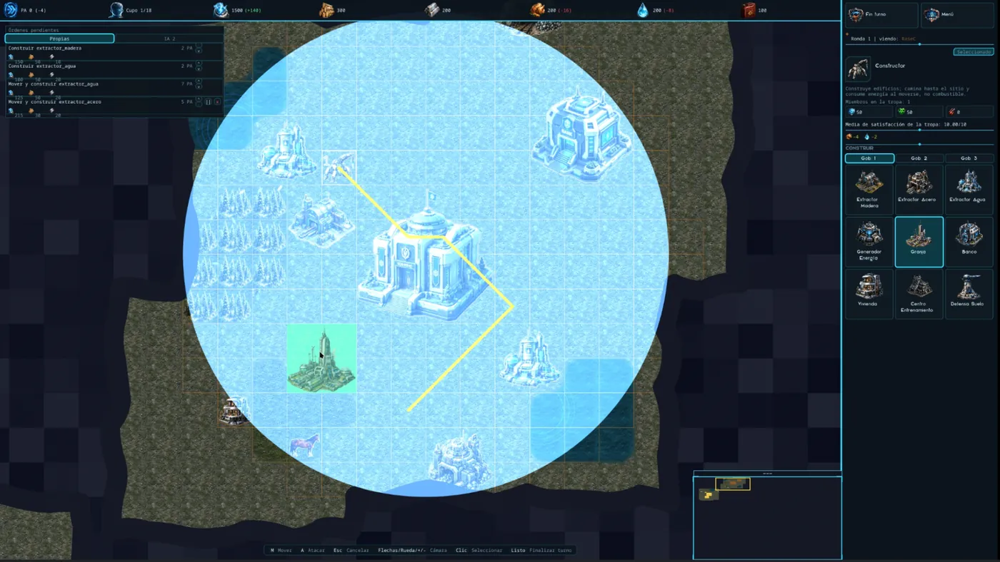</a> | **Simultaneous rounds.** Order queue, side build panel and the energy area shown when placing a building. |
| **8** | <a href="assets/img/museo/08.webp">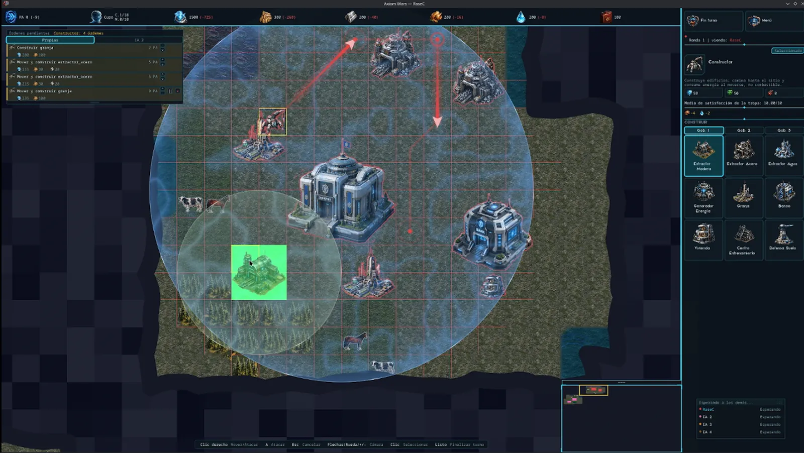</a> | **Planning on the map.** The Constructor chains move-and-build orders, arrows mark its route and the grid shows the Government's energy area. |
| **9** | <a href="assets/img/museo/09.webp">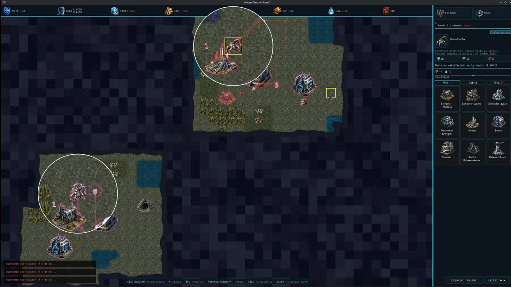</a> | **Simultaneous resolution.** Magnifiers follow the actions that happen at the same time while the round resolves. |
| **10** | <a href="assets/img/museo/10.webp">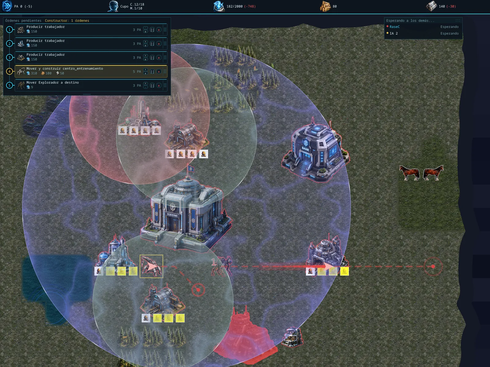</a> | **Numbered orders.** Numbered order queue, overlapping areas of effect and an Explorer heading to its destination. |
| **11** | <a href="assets/img/museo/11.webp">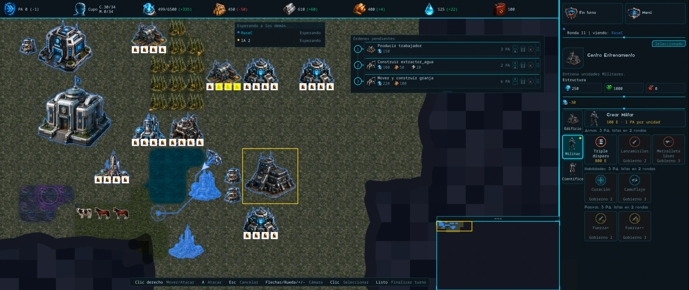</a> | **Panel by unit.** The side panel shows each unit's weapons, abilities and passives next to the pending orders queue. |
| **12** | <a href="assets/img/museo/12.webp">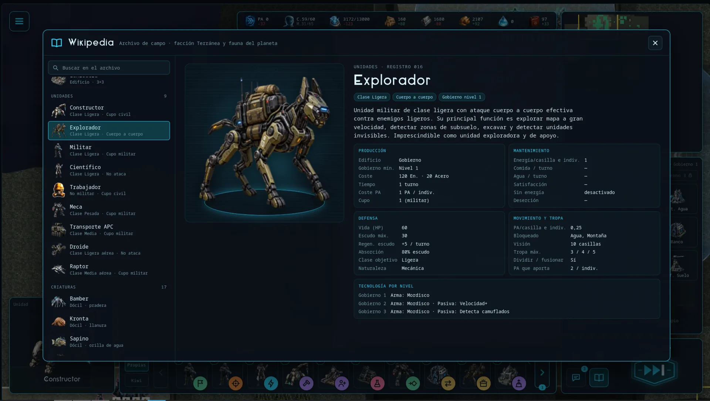</a> | **Wikipedia.** An in-game archive of buildings, units and creatures with every figure. |
| **13** | <a href="assets/img/museo/13.webp">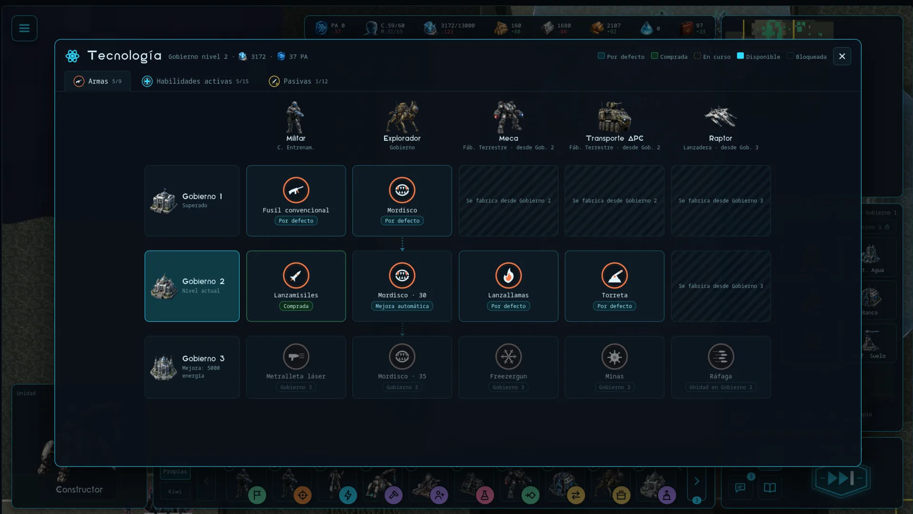</a> | **Technology.** Each unit's weapons, active abilities and passives by Government level, bought from one window. |
| **14** | <a href="assets/img/museo/14.webp">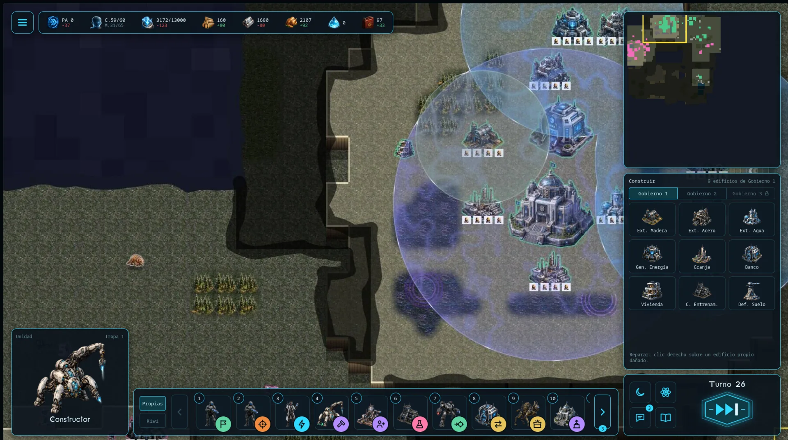</a> | **Floating interface.** Menu, resources, minimap, a build panel by Government level and an icon for each kind of order. |

## Units of the Terran Faction

Nine units, from the mine to the sky. Each sheet covers production, upkeep, defense, movement and what every Government level unlocks.

| | Unit | Class | Health | Shield | Vision |
|---|---|---|---:|---:|---:|
| 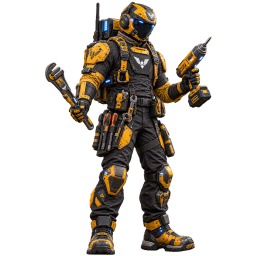 | [Worker](docs/units/trabajador.md) | Civilian, inside its building | 50 | — | — |
| 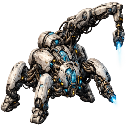 | [Constructor](docs/units/constructor.md) | Light · civilian | 50 | 50 | 4 |
| 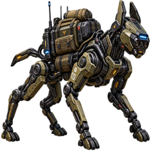 | [Explorer](docs/units/explorador.md) | Light · melee | 60 | 30 | 10 |
| 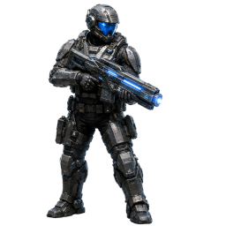 | [Military](docs/units/militar.md) | Light · ranged | 50 | 30 | 7 |
|  | [Scientist](docs/units/cientifico.md) | Light · support | 40 | 40 | 5 |
| 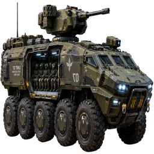 | [APC Transport](docs/units/transporte_apc.md) | Medium · transport | 150 | 100 | 6 |
| 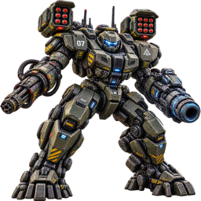 | [Mech](docs/units/meca.md) | Heavy · area | 250 | 150 | 6 |
| 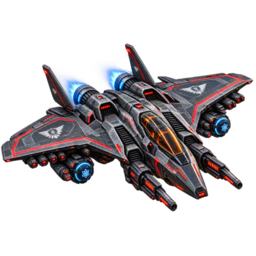 | [Raptor](docs/units/raptor.md) | Medium · air | 180 | 120 | 9 |
| 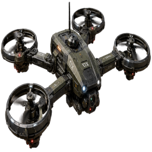 | [Droid](docs/units/droide.md) | Light · air | 60 | 120 | 8 |

Index with each unit's role: [docs/units](docs/units/README.md) · All nine sheets, print-ready: [Unit-Sheets-Terran.pdf](docs/units/Unit-Sheets-Terran.pdf)

## Damage balance

Every weapon deals full damage only to the armor it was made for, and every troop takes maximum damage from exactly three attackers (units and the two towers), so none of them rules. Each arrow leaves the attacker and points at whoever takes 100% damage from that weapon. The border of each node is its armor.

<p align="center">
  <a href="https://cesar-rgon.github.io/axiom-wars/docs/balance/damage-graph.html">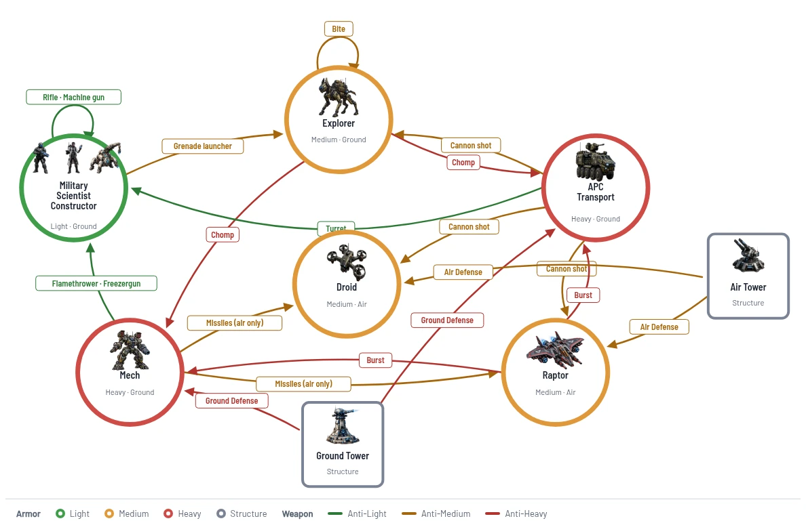</a>
  <br><sub>Click the graph to open the <a href="https://cesar-rgon.github.io/axiom-wars/docs/balance/damage-graph.html">interactive version</a>: pick a unit to light up who it beats (or, with “Takes maximum damage from”, who beats it) and fade the rest. Pick a Government level (1, 2 or 3) to see only the attacks available at it: level 1 shows the attacks of Government 1, level 2 adds those of Government 2, and level 3 shows them all.</sub>
</p>

| Weapon type | Full damage (100%) to |
|---|---|
| Anti-Light | Light armor |
| Anti-Medium | Medium armor |
| Anti-Heavy | Heavy armor and Structures |

Only the Air Defense is limited to air units; the Missiles, Turret, Cannon shot and Burst hit both ground and air.

## Map creatures

Neutral creatures that belong to no player. The docile ones wander their own habitat and give Food to whoever hunts them; the aggressive ones guard the reward containers: they sleep buried until a troop next to the chest chooses to fight, then they surface around it and fight to the death. Their level (1–5) sets the range their health, shield and damage are rolled from.

### Docile

| | Creature | Habitat | Health | Food |
|---|---|---|---:|---:|
| 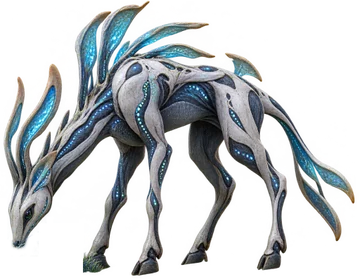 | Bamber | Grassland | 30 | 30 |
|  | Tuki | Grassland | 60 | 60 |
|  | Sapino | Water shores | 40 | 30 |
|  | Terima | Oil shores | 30 | 20 |
|  | Kronta | Plains | 50 | 40 |

### Aggressive

| | Creature | Level | Tiles | Attack | |
|---|---|---:|:---:|---|---|
|  | Aquadeso | 1 | 1×1 | Melee | Ambushes with its claws, close to the water. |
| 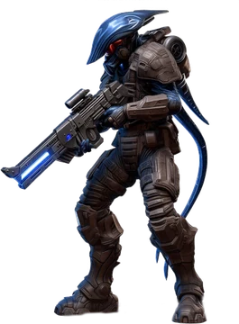 | Obidicto | 1 | 1×1 | Laser (4) | An alien soldier that fires laser pulses from 4 tiles away. |
|  | Arático | 2 | 1×1 | Web (3) | A mechanical spider: its web slows its prey for 2 rounds. |
|  | Pescualido | 2 | 1×1 | Acid ball (4) | Spits acid: half the damage goes straight through the shield. |
|  | Serpenta | 2 | 1×1 | Melee | A fast serpent with a vicious bite. |
|  | Maricobra | 3 | 1×1 | Poison area (4) | Its wings spread a poison cloud over a 3×3 area. |
|  | Zarpatauro | 3 | 1×1 | Melee | A brute whose claws are made to break heavy armor. |
|  | Aracnoso | 4 | 2×1 | Stunning blow | Its blow stuns the target for a whole round. |
| 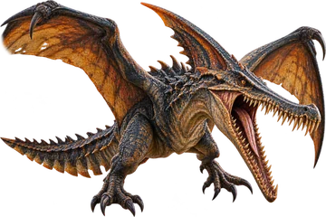 | Cocodáctilo | 4 | 2×1 | Flame area (3) | Breathes fire over a 3×3 area that keeps burning. |
|  | Devastador | 4 | 1×2 | Seeking ray (6) | Its ray arcs through up to 3 nearby targets, weaker at each jump. |
| 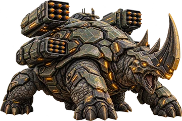 | Rinotortuga | 5 | 2×1 | Horn + missiles (5) | Mechanical. Its horn shoves troops back and its racks fire missile salvos over a 3×3 area. |
| 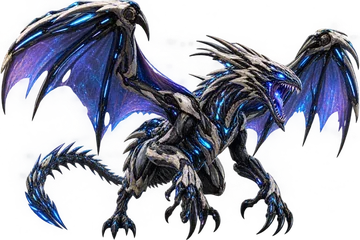 | Último Aliento | 5 | 2×2 | Area claws + blue flame (4) | The apex predator: area claws that slow, and a blue flame that breaks every shield it touches. |

## Download and play

| System | Download |
|---|---|
| Windows 64-bit | [AxiomWars-Windows-x64.zip](https://github.com/cesar-rgon/axiom-wars/releases/latest/download/AxiomWars-Windows-x64.zip) |
| Linux x86-64 | [AxiomWars-Linux-x64.zip](https://github.com/cesar-rgon/axiom-wars/releases/latest/download/AxiomWars-Linux-x64.zip) |

1. Unzip the file and open **AxiomWars.exe** (Windows) or **AxiomWars** (Linux) inside the `AxiomWars` folder. Keep the `assets` folder next to it.
2. Open the game: the server address is already filled in. Type your name, then create a lobby or join one.

## Change history

The latest version is **v2026.10.26 alpha**.

<details>
<summary>Show all versions</summary>

### v2026.10.26 alpha

- Cascade shots: if the target has already died when its order comes up, the order is cancelled without failing or spending the shot and the troop goes straight to its next target
- With several troops of different types selected, Tab walks through one type at a time: the next order goes only to that subset, the selection panel highlights it (grouped by type) and the camera centers where most of them fit
- The Space key selects the idle troops, those with no orders; Tab then walks through them by type
- The «This order replaces earlier ones» warning shows once while you hold Ctrl
- No order arrows while the turn resolves; they show in the normal turn and during the 10-second wait before a replay resolves
- The hotkey legend includes Tab and Space and wraps onto several rows when it does not fit; the tutorial advances with Enter (no longer Space)
- New lobby option: the host picks the Government level everyone starts at (1 by default); at level 2 and 3, players and AIs start with the Government at that level and a base already built (extractors and generators with 4 workers each, Bank, houses, Training Center and, at level 3, the Roboces Factory) with resources to match
- The starting buildings are placed symmetrically between players whose bases mirror each other, and everyone starts with a single Constructor
- The Space key no longer selects troops that are attacking: only those that really have no order
- Alt+click now also marks on the minimap and plays an alert sound; "J H C T" is gone from the shortcut legend
- Sprint, Extra counterattack and the Raptor's Load and Unload have their own animation and sound (they used to borrow Turbo's, the Reflector Shield's and the APC's)
- Preview while aiming: Healing, Paralyzing gas and EMP shock show their range and their circular area; Mines, Clone and Dimensional portal mark the valid targets; Stomp, Self-destruct and Load show their area when you hover the button
- New indicators while the turn resolves: an Extra counterattack badge while it is available (it breaks when spent), a Sprint trail while running, and the EMP shock lock shows as interference over the troop
- Own animation for Grenade launcher (rolling grenade), Cannon shot of the APC Transport (rail cannon from the turret) and Chomp of the Explorer (jaws); the Explorer and the APC Transport turn to face their target when attacking
- The card of a single selected troop lists its effects, positive, negative and neutral: an icon with a ring that empties as rounds pass, the name and the rounds left, and a tooltip with its description and, with Shift, its origin; with several troops selected it stays as it was
- Sprint and Extra counterattack show up as an effect on the card while their order is queued (Extra counterattack also while its second counterattack is still free)
- Dope, Camouflage, Turbo and Repair make a sound when they resolve (Camouflage, Turbo and Repair with a synthesized sound until their mp3 arrives)
- New Worker textures: an icon on extractors, generators and lists, and a full-body figure on its card, in the wiki and on the website, where it is also animated like the other troops; the tooltip of an order that produces a unit shows that unit
- Own animations and sounds for events that only had a text notice: unlocking passives, weapons and abilities each in their own way; a troop coming out of training or joining a stack; a cancelled build; failed or partial orders with a per-round summary; selling, trading, loans (granting and collecting) and transfers; requests for resources and prizes handed over between allies; an opened chest, hunting, an exhausted source, a full cap and energy at its ceiling
- More events with an effect: desertions, a troop stopped for lack of energy or fuel or by a blocked route, camouflage lost or spotted, a failed unload, splitting and merging stacks, coming up from underground, an expiring clone and a Constructor with no way through
- Marks that stay on the map: a building without energy, damaged buildings with smoke and fire, wounded troops (a medical cross on organic ones, smoke and sparks on mechanical ones), a transport with its passenger count, the active loan's clock over the Bank, the blueprint beam of a Constructor at work and the Refinery's flare
- The weather acts on the troops: in a storm a lightning bolt hits each one and in radioactivity a green pulse sweeps the ground when the turn starts
- 41 new sounds for all of the above (synthesized for now; the final mp3 files will come later); the server sends new events for these

### v2026.10.25 alpha

- Web version of the game: play in the browser at raseconline.es/axiom-wars with nothing to install; it opens straight into a 1 vs 1 match against the AI on a small map, in the language chosen on the website
- New resources panel: each resource shows what you have free now, with the queued orders already taken off, and under it what you will have next turn; colour bars, warnings of how long something that is running out will last, and the civil and military pop caps with their own bar
- Resource, AP and pop-cap tooltips are a short sum (you have, queued orders, net production, next turn); hold Shift to see the description and the breakdown of buildings, units and Bank operations
- Construction: buildings are shown in two columns with their icon, their name and a green dot if they can be built this turn or a red one if resources fall short; the order is queued anyway and waits
- Units, building and Bank actions, abilities and weapons show only an icon and a name; all of them have a tooltip with the basics and, with Shift, the full information, with what they cost and what is missing
- The furthest zoom-out is now 2.0
- The N key no longer shows the whole map: type /showallmap in the chat instead
- Actions panel with nothing selected: troops are laid out in 3 columns with bigger buttons
- Website: a Play in the browser button that opens a new tab in the chosen language, notes on the web version's performance and on Windows' unrecognised-software warning; the animated logo moves to the end of the page
- In the web version the tutorial starts afresh on every visit and Save game and Exit to menu are disabled
- The camera can go past the map edge until the Government is centered on screen, in the corners too; what lies outside is drawn as an outer plateau wall with its cliff, and cannot be built on or walked on
- Settings → Video: window resolution (from 1280×720 up to 4K, or automatic) and the monitor fullscreen opens on; the Settings menu now has two columns and wider margins
- The start screens scale up to use the window, up to 1.5 times, without being cut off
- The online counter on the start screen counts only players (named connections), not probes or menus without a name
- Microturn movement flows: leaps over allies are shown step by step without freezing the other troops, and a Meca is no longer stuck behind idle Mecas
- Mechanical troops (Meca, APC, Raptor…) explode when they die instead of falling over, and explosion fire is no longer tinted blue by night or weather
- When the enemy Government falls, the replay ends after the final lupa: the rest of the round is no longer played

### v2026.10.24 alpha

- Attacks, abilities and chest opening are resolved tile by tile together with movement, in the order they were sent; each troop's orders run in sequence
- If the target flees, your troops chase it with their available AP until it is in range and then fire; without enough AP they do not fire, so no more shots at an empty tile
- With several troops and several targets, all fire at the first one and move on to the next when it dies
- The Government can only have one unit queued at a time
- Orders accumulate by default; with Ctrl the new order replaces the troop's or Constructor's earlier ones (Settings can flip this); a notice shows when it replaces
- Attacks on targets that are already destroyed are dropped automatically instead of piling up turn after turn
- Fix: swapping allied Mechs or APCs no longer leaves ghost tiles behind that stopped whole groups from advancing
- Esc cancels what is armed and, with nothing armed, opens the menu; the yellow square no longer follows the cursor over the map
- A building button you cannot afford shows what is missing in a red notice
- Players panel with an "Always show" option in Settings; the vote to hand an absent human to the AI counts only the humans who can vote
- Turn resolution: the minimap is visible and clickable, the map can be dragged with the middle button, the "Follows my troops" camera, and off-screen magnifiers stay on the edge with an arrow and are marked on the minimap
- Buying troops: panel buttons in rows with their cost; each click adds one unit to a single order and, when you select a building, the bottom panel shows boxes to order several at once
- In the room a player can pick the colour an AI uses; the AI gets another free one
- Fix: buildings that were never built because the Constructor waited inside the footprint; a Government upgrade now holds back its resources so they can be saved up
- Fix: a saved match no longer disappears from "My matches" for players who disconnected
- The AI builds on a nearby deposit it discovers instead of going far away to find one
- Team colour: the details of every building and troop (banners, lights, signs) are painted in the player's colour, also on the panel buttons and when placing a building; when selected, a solid isometric ring at the base; they replace the thin outline, which was barely visible in a storm
- Unit production: above the building you see "5x" to the left of the unit icon and the turns left with their icon to the right, with no yellow squares below; the rally point is an isometric reticle in the player's colour
- Workers: under every extractor and generator, a panel with the new worker icon (helmet with visor), n/max, a mood face and the mean satisfaction bar, which fades if a troop is below; select the building to see each worker with its percentage
- Smoother microturns: if a troop has two moves in a row, the second starts as soon as it reaches the end of the first, without standing still while the others move
- AI on plateaus: the power generator is placed by the Constructor's real route and the ground's height (it used to go down to the plateau's foot with 50-step detours); outposts behind huge detours are skipped, one Constructor per job, and the job goes to the nearest Constructor

### v2026.10.23 alpha

- Allied troops pass through each other when moving and the slower ones move first; they no longer merge when moving as a group and life updates when the animation ends
- Resolution camera "Follow"/"Fixed" with per-zone magnifiers; it opens centred on your Government and you see others building
- "Repeat last resolution" is also available after loading a game
- Faster AI
- Blind-built generator: slopes are only judged on explored tiles; replays show creatures in the right order
- A Government being upgraded keeps producing units and energy coverage is shared between allies
- The open-container order shows the prize and its energy counts in "Forecast next turn"
- Actions panel with nothing selected or a group: troops in 4 columns with bigger icons

### v2026.10.21 alpha

- Match replays: the server records every turn and they can be watched from the menu, from one player's view or without fog; "Repeat last resolution" with a playback panel
- Manual save and "Leave to menu"; the saved list shows the turn and whether it is manual or an autosave
- Fix: the Builder no longer gets stuck inside its footprint when building; the start screen no longer shows "Recent saves"
- Three new languages: Traditional Chinese, Korean and Polish
- Start screen: the animated logo is twice as big and centred above the panels; the server pill lines up with the left panel
- Each player in the room has their own "Leave" button (including those on your PC): only that player leaves, the PC stays in the room and, if it was the host, the role passes to the oldest player on that PC; only the host keeps "Close room"

### v2026.10.20 alpha

- Start screen redesigned: this PC's players, lobbies and saved matches in a single view, with the room on the right
- Full-screen room (lobby) and "Load match" with a list, thumbnails and the detail of your base
- Six new languages: French, Italian, German, Russian, Chinese and Japanese
- Idle animations for the Terran troops and the 17 creatures
- Damage and AP rebalance (100/70/40 matrix) and Government with 14/20/26 AP and more health
- The water extractor also works next to the sea
- End-of-match statistics, magnifier and camera on the fall of the Government, and attack crosshair
- The AI picks its targets better; a group sent to unexplored terrain keeps its destination

### v2026.10.19 alpha

- Maps v2: bigger quadrants, sea with rivers, bays, lakes with islands and bridges
- Map options in the lobby: continents, peninsulas, lakes, rivers, plateaus, chests, docile creatures and resource level
- Buried chest guardians that rise from the ground when you fight
- Maximum-attack graph and new damage to building shields
- Each unit's orders run in queue order
- You can cancel the end of the turn while the AIs are planning
- Water and oil waves with interference; oil and sea block movement
- Faster APC; a buried Explorer cannot move
- systemd service for the server

### v2026.10.18 alpha

- Rebalance of weapons, armors and abilities (machine gun, grenade launcher, cannon shot, bite, Bury, Immolate, Stomp, Clone, AP Aura)
- One counterattack per troop and round; ground and air defenses depending on the Government level
- Heavy-armor APC transport; Load without a target
- Much better client graphics performance (shader shapes and fog frontier as an image)
- Credits with sound effects, ChatGPT and Gemini

### v2026.10.17 alpha

- Catalog of 58 sound effects (all 58 as mp3)
- Approach and shoot are a single order
- Buildings without power are inactive: defenses do not fire and Banks do not operate
- Pathfinding and Government exit check 15-20 times faster for the AI
- Larger action buttons and 3 workers by default

### v2026.10.16 alpha

- Large units with multi-tile footprints: Mech and APC 2×2, Raptor 3×2
- Group orders, civil and military queues with tabs, and messaging with a history of notices
- Synthesized sounds with their own volume in Settings
- Chest guardians in troops depending on the chest level; map decoration that never disconnects the terrain
- The dead of the round no longer counterattack; Exit button in the main menu

### v2026.10.14 alpha

- New textures for containers, creatures and terrain

### v2026.10.12 alpha

- Building explosions with rubble, the Government falling in a chain and resource pools that visibly run out
- Interface variant B (the map is no longer covered) and hand cursor; the menu is a centered modal
- AI: chooses whom to shoot by value, remembers hostile creatures and builds power proactively
- Line of fire with plateaus; area abilities that follow the troop; group arrival and formation by roles
- Resource balance: more grass and Energy that does not punish saving
- Unit sheets and balance report in English, published on the website

### v2026.10.11 alpha

- Double AP pool: shared camp AP and each troop's own AP
- Plateaus in rugged style: rock with strata, cracks and ramps
- Technology, Wikipedia and orders with an icon per type
- The AI respects plateaus when placing buildings

### v2026.10.10 alpha

- Map creatures: 17 real species with textures, movement and attack animations
- Docile creatures that live in their lake; chests with prizes
- Floating HUD with an orders row and configurable panels; chat and movement with WSAD
- No turn 0; priority loan and energy cap

### v2026.10.09 alpha

- Weather: random weather conditions each turn
- Neutral creatures and containers with prizes
- Hand-over between local players, credits and end music
- Animation of units when moving and of buildings under construction

### v2026.10.08 alpha

- Field advisor with a real portrait in the tutorial and the round report

### v2026.10.06 alpha

- Plateaus and ramps: one height level on the map, with cliffs
- Approach to firing range before attacking; right click to attack and firing arc
- Exploitable resources next to each Government and more oil
- Tutorial with an agenda of pending notices

### v2026.10.05 alpha

- Tutorial with the holographic advisor and round report
- Visual effects lab: one effect for each weapon, ability, passive and status
- Right panel with a rail per unit, upgrade icons and interface scale

### v2026.10.04 alpha

- Troop fatigue, energy with a cap and routes by stages (fresh, tired, out of round)
- Blind construction in unexplored fog (Energy Generator only) and group movement side by side
- Purchase of passives, weapons and abilities; AI assault
- Scripts to publish client releases on GitHub and the website

### v2026.10.03 alpha

- Terran balance v8: classes, AP per individual, fuel per tile, shield per individual
- Weapons by level with reloads, area and counterattack; abilities, passives and statuses
- New units and aircraft on their own layer; transport and mines
- Weapon and ability selector in the client

### v2026.10.02 alpha

- Map preview in the lobby with a fixed seed, enlarged when clicked
- Cancel, pause and resume any order of the queue with replanning
- Orders panel with cards on a numbered rail
- Unit sheets: Military, Mech, APC, Raptor, Droid, Explorer and Scientist

### v2026.10.01 alpha

- Lobby with a Team combo and a Ready button
- Travelling magnifier and scrollable orders panel; one Constructor per troop
- Terran unit sheets (PDF and Markdown)

### v2026.09.27 alpha

- Notices panel, moving magnifiers and simultaneous replay
- "Energy field" area of effect with a shader
- Smooth movement during resolution and route trail
- AI with Government level 2, a dedicated scout and emergency reinforcement

### v2026.09.26 alpha

- Recalculate the route when an unexpected obstacle appears
- Terrain revealed when ordering a move into the black fog
- Electric bolts and preview of the area when building

### v2026.08.31 alpha

- Batch of 21 improvements: split troops, real rationing, resolution magnifiers, exit point, cooperative victory
- Automatic magnifier when an enemy or a base is discovered
- AI with parallel speculation and a real progress bar

### v2026.08.30 alpha

- Pop split into Civil (Housing) and Military (Energy Generator)
- Rebalance of water extractors and farms
- The AI avoids the Food debt spiral

### v2026.08.29 alpha

- Fix for an AI freeze during parallel planning

### v2026.08.28 alpha

- The AI prioritizes construction, production and upgrades according to what it can afford

### v2026.08.27 alpha

- The AI hires every free slot, banks proactively and remembers enemy bases
- Balance of energy, steel and food; grassland as the dominant resource
- Less pixelated crosshair and full-width start-screen background

### v2026.08.25 alpha

- Up to 8 local players and up to 8 per lobby
- Fixed camera and magnifying crosshair during resolution, with pause on Space
- Fixed 3 AP per attack and orders locked after Ready
- Paste into the Host field; shortcut legend

### v2026.08.23 alpha

- Iron mines equidistant between players
- Live progress bar while the AI resolves
- Finalize lobby, and separate screens for Find lobby and Load match

### v2026.08.22 alpha

- 8-player map with 49 quadrants
- The camera focuses on combat; Bank redesigned
- Turn 0 can be undone
- Merged wizard, languages with full names and recoil bursts

### v2026.08.21 alpha

- The AI builds the economy in order (wood, water, farm, steel, energy) and hires staff first
- The Government produces energy and starting resources go up
- Extractors can be built with a single adjacent tile

### v2026.08.20 alpha

- New AI: RHEA (rolling horizon evolutionary algorithm) replaces the rule-based AI
- Queued constructions are also visible to enemies with vision
- Government resources with a minimum spacing between them

### v2026.08.19 alpha

- Stable lobby order and non-atomic batch production

### v2026.08.18 alpha

- Animated logo in the wizard and in turn changes
- Pre-game screens in 16:9 format; date in the lobby list

### v2026.08.17 alpha

- Symmetric map generation across the quadrants
- AP split across rounds for any order; energy costs by Government level
- Turn 0 with confirmation or relocation of the Government

### v2026.08.10 alpha

- Persistent lobbies that can be resumed; long marches that continue on their own
- Full pathfinding over real terrain, hidden under the fog
- Pause, resume and reorder orders; resource reservation for queued orders
- Allies' order queue; improved loans and Bank

### v2026.08.09 alpha

- Simultaneous rounds: all players queue orders and the round resolves at once
- Preview of routes and costs of queued orders
- Waiting room and skippable replay

### v2026.08.08 alpha

- Per-individual satisfaction and rationing system, instead of starvation
- Ambient production effects and ripples on water and oil
- Minimap placed according to the side of the map where the Government is

### v2026.08.06 alpha

- Terrain edges blended with the neighbor and rounded corners
- The Constructor walks through neutral grass creatures
- Help with scrollbars and richer statistics

### v2026.08.05 alpha

- Resource forecast with jobs that finish in the same round
- Energy coverage as a true circle from the building's center

### v2026.08.04 alpha

- Named saves (checkpoints) and help panel
- Floating minimap and chat log at the bottom
- Bank history and a block on negative loans
- Resource tooltips with an AP and Pop breakdown

### v2026.08.03 alpha

- Neutral grass creatures (cow and horse)
- Constructor limited to one construction order and dual AI exploration
- Redesigned tooltips and terrain edges

### v2026.08.02 alpha

- Mandatory turn 0 to place the starting buildings
- Government energy area; central lakes in map generation
- Redesigned panel with an info card, buttons with icons and custom cursors

### v2026.08.01 alpha

- Constructor unit and construction flow
- Ready button in the lobby and editable text cursor
- Redesigned mouse controls and live cooperative view
- Fair map between players and energy coverage

### v2026.07.31 alpha

- Split and merge troops
- Hunger and thirst icons; keyboard scrolling
- The camera recenters at the start of the turn; replay of the AI's turn
- Square maps and 2×2 steel mines

### v2026.07.30 alpha

- The pre-game screens are merged into a single wizard
- Combat effects, victory screen and attack budget per turn
- PvP/Cooperative lobby start validation

### v2026.07.29 alpha

- Local multiplayer on the same PC (hotseat) with hand-over between players
- Spanish and English languages, Settings window and volume

### v2026.07.28 alpha

- Batch unit production and resource transfers between allies
- Oil pools as a new terrain with an adjacent refinery
- Unit quantity modal and interface improvements

### v2026.07.27 alpha

- Multiplayer with several PvP/Cooperative lobbies, saving and loading matches
- Lobby browser, load-match screen and the Axiom Wars brand

### v2026.07.26 alpha

- Multi-turn route movement with a dotted route and estimated time
- Building sale, ranged attack and real combat
- Larger, more expansive map

### v2026.07.25 alpha

- Fog of war, faction color selection and the first enemy AI
- Basic melee combat and Bank with loans
- Hunger and thirst per individual and forecast of next turn's resources
- Redesigned match HUD with a top resource bar and music

### v2026.07.24 alpha

- Start of the project: Go server and graphical client with Ebiten
- Multi-tile buildings, forests as obstacles and minimap
- Red/green preview when building and build panel with tabs per level
- Futuristic cyan-on-black theme with the Elianto font

</details>

## Credits

<table>
  <tr>
    <td align="center" width="17%" valign="top"><sub>Creator and analyst</sub><br>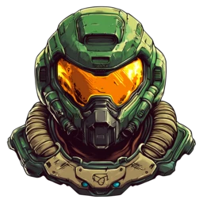<br><b>RaseC</b></td>
    <td align="center" width="17%" valign="top"><sub>Programmer</sub><br><br><b>Claude AI</b></td>
    <td align="center" width="32%" valign="top"><table>
      <tr><td align="center" colspan="2"><sub>Designers</sub></td></tr>
      <tr><td align="center"></td><td align="center"></td></tr>
      <tr><td align="center"><b>ChatGPT AI</b></td><td align="center"><b>Gemini AI</b></td></tr>
    </table></td>
    <td align="center" width="17%" valign="top"><sub>Composer</sub><br><picture><source media="(prefers-color-scheme: dark)" srcset="assets/img/credits/suno-pad.svg"></picture><br><b>Suno AI</b></td>
    <td align="center" width="17%" valign="top"><sub>Sound effects</sub><br><picture><source media="(prefers-color-scheme: dark)" srcset="assets/img/credits/elevenlabs-pad.svg"></picture><br><b>ElevenLabs AI</b></td>
  </tr>
</table>

**Contributing analysts:** Gameover · Kattaros · Kiwi

**Testers:** Calheb · Chara · Fr4nk50 · Gameover · Kattaros · Kiwi · Miky · Navajita · Nightlane · RaseC

## About this repository

This repository hosts the game's website (GitHub Pages) and the client downloads (Releases). The game's code is developed separately.

```
index.html          website published at https://cesar-rgon.github.io/axiom-wars/
assets/img/         logo, units, gallery, museum and credits
assets/js/i18n.js   language switcher of the website (English is the default)
assets/i18n/        one file per language: es, fr, it, de, ru, zh, zh-TW, ja, ko, pl, pt-BR, tr
docs/units/         Terran unit sheets (Markdown and PDF)
docs/balance/       interactive damage graph (English)
docs/unidades/      the same unit sheets in Spanish
docs/balanceo/      the same graph in Spanish
tools/make_logo.py  cuts the original logo out to a transparent PNG
```

Each release contains only the client binaries for Windows and Linux; the server is not distributed.
