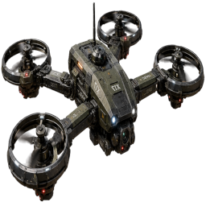

# Droide

_Nueva unidad · Facción Terránea_

`Clase Media aérea` · `No ataca` · `Lanzadera`

> Unidad aérea de apoyo de clase media, sin ataque. Designa objetivos para que su bando les haga más daño, tapa la vista con granadas de humo y puede clonar tropas aliadas.

## Características

### Producción

| Edificio | Gobierno mín. | Coste | Tiempo | Coste PA | Cupo |
|---|---|---|---|---|---|
| Lanzadera | Nivel 3 | 250 En. · 80 Acero | 2 turnos | 2 PA / indiv. | 2 (militar) |

### Combustible

| Comb. / casilla | Energía / turno | Agua / turno | Satisfacción | Sin combustible | Deserción |
|---|---|---|---|---|---|
| 1 | 10 | — | — | no se mueve | — |

### Defensa

| Vida (HP) | Escudo máx. | Regen. escudo | Ataque | Clase objetivo | Naturaleza |
|---|---|---|---|---|---|
| 100 | 150 | +5 / turno | — (no ataca) | Media (aérea) | Mecánica |

### Movimiento y tropa

| PA / casilla | Bloqueado | Visión | Tropa máx. | Dividir / fusionar | PA que aporta |
|---|---|---|---|---|---|
| 0,3 | Nada (vuela) | 8 casillas | 1 (no se agrupa) | No | 4 |

## Gobierno 1

_No disponible: El Droide se fabrica en la Lanzadera, que requiere Gobierno nivel 3_

## Gobierno 2

_No disponible: El Droide se fabrica en la Lanzadera, que requiere Gobierno nivel 3_

## Gobierno 3

| | Nombre | Detalles |
|---|---|---|
| ⚔️ Arma | _no aplica_ |  |
| ✨ Activa | **Clonar** | Coste 2 PA y 200 energía · Recarga 1 vez cada 6 turnos · Efecto Copia todas las tropas aliadas del 3x3: señuelos con el 50% de vida, 3 turnos, sin daño ni cupo. 200 de energía por tropa copiada. Alcance 4. · Compra 5000 energía |
| ✨ Activa | **Designar objetivo** | Coste 2 PA y 100 energía · Recarga 1 vez cada 4 turnos · Efecto Marca una tropa o edificio enemigo durante 2 turnos: los ataques de tu bando le hacen +30% de daño. Alcance 5. · Compra 2500 energía |
| ✨ Activa | **Granadas de humo** | Coste 2 PA y 150 energía · Recarga 1 vez cada 5 turnos · Efecto Lanza 3 granadas: una donde apuntas y dos al azar dentro del alcance. Cada nube (5x5) dura 2 turnos: nadie ve su interior desde fuera y quien está dentro solo ve las casillas adyacentes. Alcance 5. · Compra 4000 energía |
| 🛡️ Pasiva | **Reinicio** | Condición Siempre · Efecto -1 turno de enfriamiento en las armas y habilidades de los aliados adyacentes (mínimo 1, no se acumula). · Compra 5000 energía |
| 🛡️ Pasiva | **Propulsión++** | Condición Siempre · Efecto Otro +1 PA propio por individuo a Raptors y Droides. · Compra 5000 energía (requiere Propulsión+) |

---

Unidad nueva · Compra: en su edificio, 3 PA, 2 turnos · Perfil: % L/M/P/Estr.

[← Todas las unidades](README.md)
