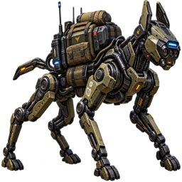

# Explorador

_Nueva unidad · Facción Terránea_

`Clase Media` · `Cuerpo a cuerpo` · `Gobierno nivel 2`

> Unidad militar de clase media con ataque cuerpo a cuerpo: el Mordisco es eficaz contra enemigos ligeros y la Dentellada contra los pesados. Su principal función es explorar el mapa a gran velocidad, moverse bajo tierra y detectar unidades invisibles. Imprescindible como unidad exploradora y de apoyo.

## Características

### Producción

| Edificio | Gobierno mín. | Coste | Tiempo | Coste PA | Cupo |
|---|---|---|---|---|---|
| Gobierno | Nivel 2 | 120 En. · 20 Acero | 1 turno | 1 PA / indiv. | 1 (militar) |

### Mantenimiento

| Energía/casilla e indiv. | Energía / turno | Agua / turno | Satisfacción | Sin energía | Deserción |
|---|---|---|---|---|---|
| 1 | 2 | — | — | desactivado | — |

### Defensa

| Vida (HP) | Escudo máx. | Regen. escudo | Absorción | Clase objetivo | Naturaleza |
|---|---|---|---|---|---|
| 88 | 40 | +5 / turno | 80% escudo | Media | Mecánica |

### Movimiento y tropa

| PA/casilla e indiv. | Bloqueado | Visión | Tropa máx. | Dividir / fusionar | PA que aporta |
|---|---|---|---|---|---|
| 0,25 | Agua, Montaña | 10 casillas | — / 6 / 8 | Sí | 3 / 4 / 5 / indiv. |

## Gobierno 1

_No disponible: El Explorador se fabrica en el Gobierno a partir del nivel 2_

## Gobierno 2

| | Nombre | Detalles |
|---|---|---|
| ⚔️ Arma | **Mordisco** | Modalidad Terrestre · Daño 46 × individuo · Tipo/alcance Cuerpo a cuerpo · Perfil AntiLigera 100/70/40/40% · Efecto Daño según Gobierno: G2 46 · G3 53. · Ataques/turno Cada turno · Coste PA 1 PA por individuo · Compra Incluida con la unidad |
| ✨ Activa | **Enterrar bajo tierra** | Coste 2 PA y 20 energía · Recarga 1 vez cada 2 turnos · Efecto Se entierra: invisible salvo para Gobiernos y Exploradores enemigos sin enterrar. Enterrado ataca lo que tenga encima o al lado: sale a la superficie y paga 20 de Energía por individuo. Solo se mueve con Moverse enterrado. Se activa y se cancela. · Compra 2500 energía |
| 🛡️ Pasiva | **Detectar ocultos** | Condición Siempre · Efecto Ve unidades ocultas (camufladas o enterradas) y minas dentro de su visión mientras no esté enterrado. · Compra 2500 energía |

## Gobierno 3

| | Nombre | Detalles |
|---|---|---|
| ⚔️ Arma | **Dentellada** | Modalidad Terrestre · Daño 56 × individuo · Tipo/alcance Cuerpo a cuerpo · Perfil AntiPesada 40/70/100/100% · Ataques/turno Cada turno · Coste PA 1 PA por individuo · Compra 3000 energía |
| ✨ Activa | **Inmolar** | Coste 3 PA y 50 energía · Recarga Cada turno · Efecto Toda la tropa explota en 3x3: 60 por individuo (100% en el centro, 50% alrededor). Explosivo. · Compra 5000 energía |
| 🛡️ Pasiva | **Moverse enterrado** | Condición Siempre · Efecto Enterrado se mueve a la mitad de velocidad y al doble de Energía por casilla, por debajo de tropas pero no de edificios. Puede acercarse a un enemigo bajo tierra y salir a atacarlo. · Compra 5000 energía |

---

Unidad nueva · Compra: en su edificio, 3 PA, 2 turnos · Perfil: % L/M/P/Estr.

[← Todas las unidades](README.md)
