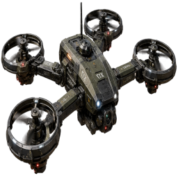

# Droid

_New unit · Terran Faction_

`Medium Air Class` · `No attack` · `Launch Pad`

> Medium-class air support unit with no attack. It designates targets so its side deals them more damage, blocks sight with smoke grenades and can clone allied troops.

## Stats

### Production

| Building | Min. Government | Cost | Time | AP cost | Cap |
|---|---|---|---|---|---|
| Launch Pad | Level 3 | 250 En. · 80 Steel | 2 turns | 2 AP / indiv. | 2 (military) |

### Fuel

| Fuel / tile | Energía / turno | Water / turn | Satisfaction | Without fuel | Desertion |
|---|---|---|---|---|---|
| 1 | 10 | — | — | cannot move | — |

### Defense

| Health (HP) | Max. shield | Shield regen. | Attack | Target class | Nature |
|---|---|---|---|---|---|
| 100 | 150 | +5 / turn | — (no attack) | Medium (air) | Mechanical |

### Movement and troop

| AP / tile | Blocked by | Vision | Max. troop | Split / merge | AP contributed |
|---|---|---|---|---|---|
| 0.3 | Nothing (flies) | 8 tiles | 1 (does not group) | No | 4 |

## Government 1

_Not available: The Droid is built at the Launch Pad, which requires Government level 3_

## Government 2

_Not available: The Droid is built at the Launch Pad, which requires Government level 3_

## Government 3

| | Name | Details |
|---|---|---|
| ⚔️ Weapon | _not applicable_ |  |
| ✨ Active | **Clone** | Cost 2 AP and 200 energy · Cooldown Once every 6 turns · Effect Copies every allied troop in 3x3: decoys with 50% health, 3 turns, no damage and no cupo. 200 energy per troop copied. Range 4. · Purchase 5000 energy |
| ✨ Active | **Designate Target** | Cost 2 AP and 100 energy · Cooldown Once every 4 turns · Effect Marks an enemy troop or building for 2 turns: your side's attacks deal +30% damage to it. Range 5. · Purchase 2500 energy |
| ✨ Active | **Smoke Grenades** | Cost 2 AP and 150 energy · Cooldown Once every 5 turns · Effect Throws 3 grenades: one where you aim and two at random within range. Each cloud (5x5) lasts 2 turns: nobody outside sees into it and whoever is inside only sees the adjacent tiles. Range 5. · Purchase 4000 energy |
| 🛡️ Passive | **Reboot** | Condition Always · Effect -1 turn of cooldown on the weapons and abilities of adjacent allies (minimum 1, does not stack). · Purchase 5000 energy |
| 🛡️ Passive | **Propulsion++** | Condition Always · Effect Another +1 own AP per individual for Raptors and Droids. · Purchase 5000 energy (requires Propulsion+) |

---

New unit · Purchase: at its building, 3 AP, 2 turns · Profile: % L/M/H/Struct.

[← All units](README.md)
