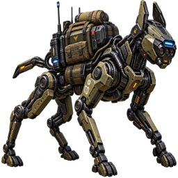

# Explorer

_New unit · Terran Faction_

`Medium Class` · `Melee` · `Government level 2`

> Medium-class military unit with a melee attack: the Bite is effective against light enemies and the Chomp against heavy ones. Its main role is to explore the map at great speed, move underground and detect invisible units. Essential as a scouting and support unit.

## Stats

### Production

| Building | Min. Government | Cost | Time | AP cost | Cap |
|---|---|---|---|---|---|
| Government | Level 2 | 120 En. · 20 Steel | 1 turn | 1 AP / indiv. | 1 (military) |

### Upkeep

| Energy/tile per indiv. | Energía / turno | Water / turn | Satisfaction | Without energy | Desertion |
|---|---|---|---|---|---|
| 1 | 2 | — | — | disabled | — |

### Defense

| Health (HP) | Max. shield | Shield regen. | Absorption | Target class | Nature |
|---|---|---|---|---|---|
| 88 | 40 | +5 / turn | 80% shield | Medium | Mechanical |

### Movement and troop

| AP/tile per indiv. | Blocked by | Vision | Max. troop | Split / merge | AP contributed |
|---|---|---|---|---|---|
| 0.25 | Water, Mountain | 10 tiles | — / 6 / 8 | Yes | 3 / 4 / 5 / indiv. |

## Government 1

_Not available: The Explorer is built at the Government from level 2_

## Government 2

| | Name | Details |
|---|---|---|
| ⚔️ Weapon | **Bite** | Mode Ground · Damage 46 × individual · Type/range Melee · Profile AntiLight 100/70/40/40% · Effect Damage by Government level: G2 46 · G3 53. · Attacks/turn Every turn · AP cost 1 AP per individual · Purchase Included with the unit |
| ✨ Active | **Burrow** | Cost 2 AP and 20 energy · Cooldown Once every 2 turns · Effect Buries itself: invisible except to enemy Governments and unburied Scouts. While buried it attacks what is on its tile or beside it: it surfaces and pays 20 Energy per individual. It only moves with Burrow Move. Toggles on and off. · Purchase 2500 energy |
| 🛡️ Passive | **Detect hidden** | Condition Always · Effect Sees hidden units (camouflaged or buried) and mines within its vision while it isn't buried. · Purchase 2500 energy |

## Government 3

| | Name | Details |
|---|---|---|
| ⚔️ Weapon | **Chomp** | Mode Ground · Damage 56 × individual · Type/range Melee · Profile AntiHeavy 40/70/100/100% · Attacks/turn Every turn · AP cost 1 AP per individual · Purchase 3000 energy |
| ✨ Active | **Immolate** | Cost 3 AP and 50 energy · Cooldown Every turn · Effect The whole troop explodes in 3x3: 60 per individual (100% at the centre, 50% around). Explosive. · Purchase 5000 energy |
| 🛡️ Passive | **Burrow Move** | Condition Always · Effect Buried, it moves at half speed and double Energy per tile, under troops but not buildings. It can creep up on an enemy underground and surface to attack. · Purchase 5000 energy |

---

New unit · Purchase: at its building, 3 AP, 2 turns · Profile: % L/M/H/Struct.

[← All units](README.md)
