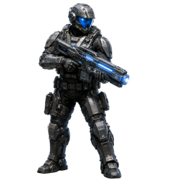

# Military

_Infantry unit · Terran Faction_

`Light Class` · `Military cap` · `Training Center`

> Light-class military unit trained for ranged combat. A basic but versatile unit: the Laser machine gun is effective against light enemies, and the Rifle and the Grenade launcher against medium-class ones. The Laser machine gun and the Rifle also reach air units, with less accuracy.

## Stats

### Production

| Building | Min. Government | Cost | Time | AP cost | Cap |
|---|---|---|---|---|---|
| Training Ctr. | Level 1 | 100 Energy | 1 turn | 1 AP / indiv. | 1 (military) |

### Upkeep

| Food / turn | Water / turn | Fuel | Satisfaction | Desertion | Rationing |
|---|---|---|---|---|---|
| 4 | 2 | — | 0–10 | Satisf. 0 | Individual |

### Defense

| Health (HP) | Max. shield | Shield regen. | Absorption | Target class | Nature |
|---|---|---|---|---|---|
| 56 | 29 | +5 / turn | 80% shield | Light | Organic |

### Movement and troop

| AP/tile per indiv. | Blocked by | Fatigue | Vision | Max. troop | AP contributed |
|---|---|---|---|---|---|
| 0.5 | Water, Mountain | 10 tiles; then ×(1+k/2) | 7 tiles | 4 / 6 / 7 · divisible | 3 / 4 / 5 / indiv. |

## Government 1

| | Name | Details |
|---|---|---|
| ⚔️ Weapon | **Laser machine gun** | Mode Ground-to-Air · Damage 20 × individual · Type/range Ranged · 5 · Profile AntiLight 100/70/40/40% · Effect Damage by Government level: G1 20 · G2 13 · G3 12. Against aircraft 30% of the shots hit. · Attacks/turn Every turn · AP cost 1 AP per individual · Purchase Included with the unit |
| ✨ Active | **Sprint** | Cost 20 energy per individual · Cooldown Once every 3 turns · Effect One more tile of movement this turn with its current AP. · Purchase 1000 energy |
| 🛡️ Passive | _not applicable_ |  |

## Government 2

| | Name | Details |
|---|---|---|
| ⚔️ Weapon | **Rifle** | Mode Ground-to-Air · Damage 20 × individual · Type/range Ranged · 5 · Profile AntiMedium 70/100/70/70% · Effect Damage by Government level: G2 20 · G3 18. Against aircraft 50% of the shots hit. Precision: half the damage ignores the shield. · Attacks/turn Every turn · AP cost 2 AP per individual · Purchase 2000 energy |
| ✨ Active | **Extra counterattack** | Cost 30 energy per individual · Cooldown Once every 3 turns · Effect This turn the troop counter-attacks a second time, at 25% damage. · Purchase 2500 energy |
| 🛡️ Passive | **Strength+** | Condition Always · Effect +25 health (75), also for units already created. · Purchase 2500 energy |
| 🛡️ Passive | **Training+** | Condition Always · Effect +1 own AP per individual for Military and Scientists. · Purchase 2500 energy |

## Government 3

| | Name | Details |
|---|---|---|
| ⚔️ Weapon | **Grenade launcher** | Mode Ground · Damage 30 × individual · Type/range Ranged · 4 · Profile AntiMedium 70/100/70/70% · Attacks/turn Every turn · AP cost 2 AP per individual · Purchase 4000 energy |
| ✨ Active | **Camouflage** | Cost 2 AP + 10 energy per individual and turn · Cooldown Every 3 turns after breaking · Effect Invisible until it attacks, runs out of energy or cancels. · Purchase 4000 energy |
| 🛡️ Passive | **Strength++** | Condition Always · Effect +25 more health (100 in total). · Purchase 5000 energy (requires Strength+) |
| 🛡️ Passive | **Training++** | Condition Always · Effect Another +1 own AP per individual for Military and Scientists. · Purchase 5000 energy (requires Training+) |

---

Purchase: at its building, 3 AP, 2 turns · Profile: % L/M/H/Struct.

[← All units](README.md)
